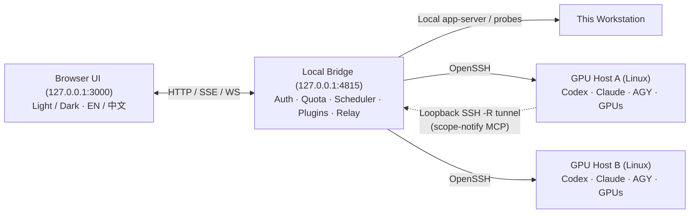

# SCOPE

**English** | [简体中文](./README.zh-CN.md)

[](./LICENSE)
[](https://nodejs.org/)

### **One monitor for all agent sessions.**

Run **Codex**, **Claude Code**, and **Antigravity (`agy`)** across your laptop and dozens of Linux SSH / GPU servers—without losing track of `tmux` panes, pending approval prompts, background subagents, or subscription quotas. **SCOPE** discovers your native agent sessions in place and brings live streaming, approvals, files, GPUs, and quotas into a single loopback web workbench (`127.0.0.1`).

---

## Why SCOPE?

- **One monitor for all agent sessions**: Automatically discovers sessions you already started in VS Code, terminals, or `tmux` (`~/.codex/sessions`, `~/.claude/projects`, `~/.gemini/antigravity-cli`) and resumes them by native session ID—zero vendor lock-in, zero broken CLI history.
- **Live streaming, approvals & background subagents**: Approve file edits and shell commands, answer interactive forms (`requestUserInput`, `AskUserQuestion`, ACP forms), queue follow-up messages, switch models/reasoning effort, interrupt turns safely, and watch live **background subagents** (`Claude Code` & `Antigravity`) working in real time.
- **Multi-agent account hub & live `/usage` quotas**: Inspect login status and live remaining subscription quotas across **Codex** (`app-server` rate limits + multi-profile auto-failover), **Claude Code** (5h / 7d OAuth usage), and **Antigravity** (grouped 5h / weekly quota via `agy -p /usage --output-format json`), plus one-click built-in Web SSH Terminal login.
- **GPU ownership & session concurrency pool**: Live `nvidia-smi` telemetry and training/evaluation process trees are matched to the agent sessions owning each GPU. Manage long-running Codex sessions with a per-host resident session pool and explicit session pinning (**Reserve**).
- **Cross-project Coordinator**: A read-only coordinator chat with access to your cross-host session and GPU snapshot to compare runs, locate stuck jobs, or draft tasks in one place.
- **Local-first & zero baked-in secrets**: Every SSH host, outbound proxy (`preLaunchCommand`), SMTP credential, gateway token, and local leak denylist stays in your git-ignored `.scope/` directory.



---

## Quickstart

### Requirements

- **Control machine (running SCOPE)**: Windows, macOS, or Linux with **Node.js `>= 22.13`**, **Python 3**, and **OpenSSH (`ssh`)**
- **Remote servers**: Linux with **Python 3**, key-based non-interactive SSH (`BatchMode=yes`), and `tmux` (for durable Codex sessions)
- **Agent CLIs**: Installed on the target machines where you run them (`codex`, `claude`, `agy`, or optional `dsh`)

### Start Locally

```sh
git clone <this-repository-url> scope
cd scope
npm ci
npm run scope
```

Open **http://localhost:3000/**. Both the Web UI (`3000`) and Bridge (`4815`) bind strictly to `127.0.0.1`.

1. Toggle UI language anytime via **`EN / 中`** in the top bar.
2. Open **Settings → Hosts & Remote Deploy** to configure optional per-host pre-launch commands (such as outbound proxies or Conda init) and deploy `scope-notify` with one click.
3. Open **Accounts** from the topbar (or inside any Claude/AGY session) to inspect Codex, Claude Code, and Antigravity login states and live remaining quotas.

---

## Agent & Feature Support

| Capability | Codex | Claude Code | Antigravity (`agy`) | DSH |
| --- | --- | --- | --- | --- |
| Live streaming & native session resume | Yes (`app-server` & local) | Yes (`stream-json`) | Yes (`ACP`) | Headless single-turn |
| Interactive approvals & question forms | Yes | Yes | Yes | — |
| Model & reasoning effort switching | Yes | Yes | Yes | Profile-based |
| Live subscription remaining quota (`/usage`) | Yes (5h / 7d + multi-profile) | Yes (5h / 7d OAuth usage) | Yes (grouped 5h / weekly) | — |
| Background subagents live status | Rollout subagent tree | Yes (live + `subagents/`) | Yes (ACP + child transcripts) | — |
| Slash commands & project skills | Yes (`skills/list` + `/compact`) | Yes (live CLI commands) | Yes (ACP session commands) | — |
| External terminal / VS Code observation | Yes (read-only watch) | History scan | History scan | — |
| Remote CLI check / install / upgrade | Yes (safe hot-switch) | Yes | Version check | Yes |

---

## Optional Local Configuration

All runtime state—host pre-launch commands, SMTP secrets (`0600`), remote tunnels, gateway tokens, and installed plugins—lives inside the git-ignored `.scope/` directory:

- Copy `examples/deployment.example.json` to `.scope/deployment.json` only if you want to opt into optional integrations (`taskQueue`, `dlcHostname`, `proxyBootstrapHosts`, or legacy `emailTunnelHost`).
- Copy `examples/leak-denylist.example.json` to `.scope/leak-denylist.json` to block organization-specific hostnames, IPs, or codenames during `npm run export:opensource -- --check`.

---

## Documentation

- **[Complete Deployment Guide](./docs/deployment.md)** — Workstation mode, persistent Linux `systemd --user` server deployment, Tailscale Serve & LAN HTTPS gateways, SSH/proxy setup, concurrency pools, multi-agent quotas, operations, and troubleshooting
- **[Plugin Integration & Development Guide (v1)](./docs/plugin-protocol.md)** — End-to-end guide to authoring, inspecting, installing, calling, and securing SCOPE plugins (plus extending built-in views & new agent providers)
- [Quickstart & SSH Setup](./docs/getting-started.md) — Short setup reference
- [Agents, Sessions & Approvals](./docs/agents-and-sessions.md) — Codex multi-account failover, Claude/AGY streaming, attachments, and reversible archiving
- [Email Notifications & Remote Bootstrap](./docs/notifications-and-remote.md) — Web SMTP presets and non-root `scope-notify` MCP deployment
- [Architecture Overview](./docs/architecture.md) — Module layout for contributors
- [Contributing](./CONTRIBUTING.md) · [Security Model](./SECURITY.md)

---

## Development & Verification

```sh
npm run typecheck
npm run build
npm run test:unit
npm run lint
npm run export:opensource -- --check
```

> Optional local leak denylist: copy `examples/leak-denylist.example.json` to `.scope/leak-denylist.json` (git-ignored) to block organization-specific hostnames, IPs, or codenames during `export:opensource -- --check`.

## License

[MIT](./LICENSE)
