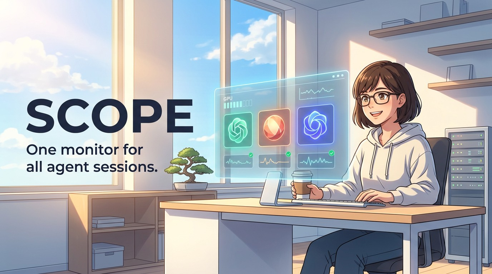
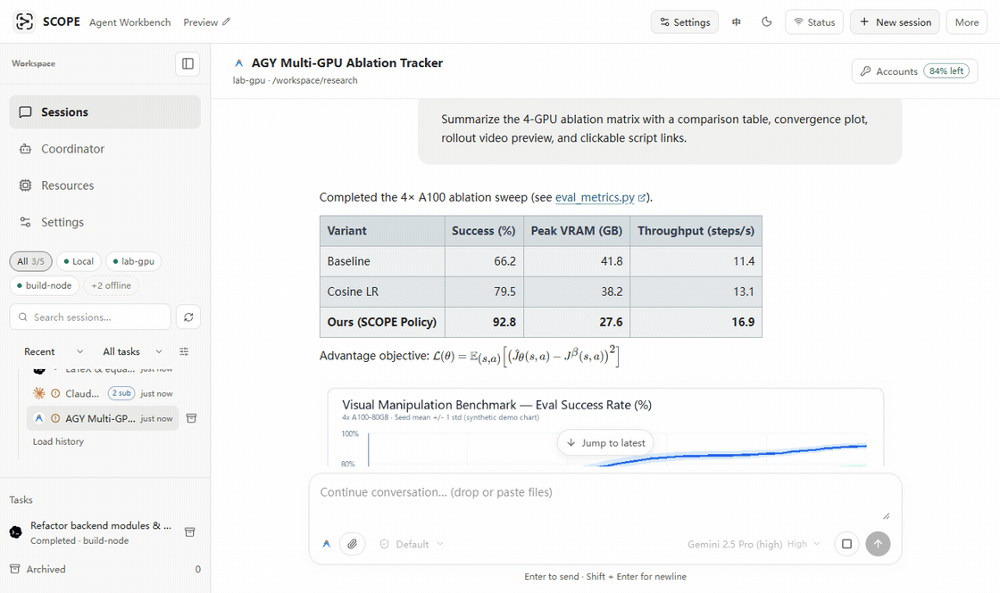
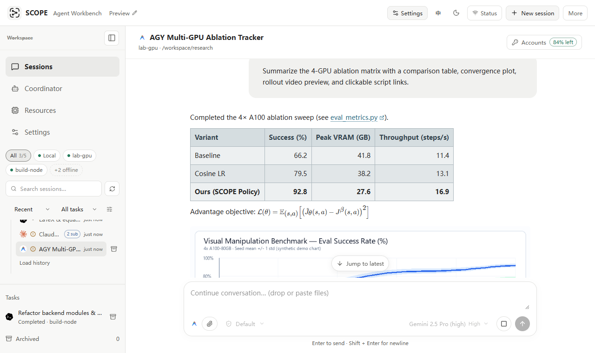
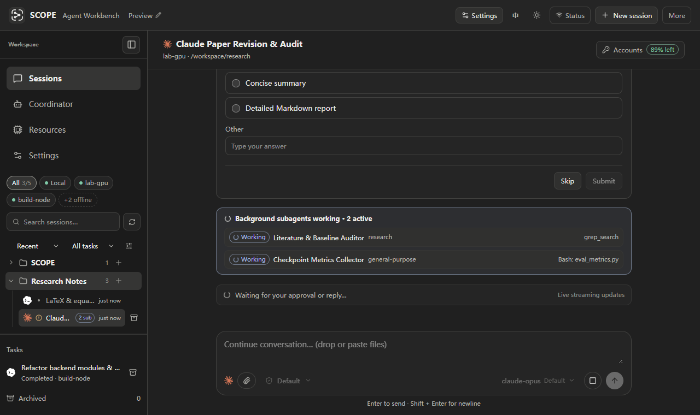
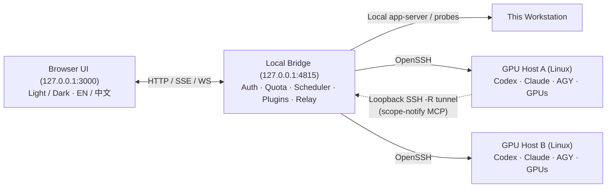

<p align="center">
  
</p>

<h1 align="center">SCOPE</h1>

<p align="center">
  <strong>One monitor for all agent sessions.</strong><br/>
  Unify <b>Codex</b>, <b>Claude Code</b>, and <b>Antigravity (<code>agy</code>)</b> across your workstation and Linux SSH GPU servers in one local-first web workbench.
</p>

<p align="center">
  <b>English</b> | <a href="https://github.com/securityCFS/SCOPE/blob/main/README.zh-CN.md">简体中文</a> |
  <a href="https://github.com/securityCFS/SCOPE/blob/main/docs/remote-access.md">Phone &amp; Remote Access (Tailscale / Cloudflare)</a> |
  <a href="https://github.com/securityCFS/SCOPE/blob/main/docs/deployment.md">Deployment Guide</a> |
  <a href="https://github.com/securityCFS/SCOPE/blob/main/docs/plugin-protocol.md">Plugin Guide</a>
</p>

<p align="center">
  <a href="https://www.npmjs.com/package/@godchaser/scope"></a>
  <a href="https://github.com/securityCFS/SCOPE/blob/main/LICENSE"></a>
  <a href="https://nodejs.org/">= 22.13" /></a>
  
  
  
</p>

---

## Live Interactive Walkthrough

<p align="center">
  
</p>

<p align="center">
  <sub>Recorded from <code>SCOPE_PREVIEW_LOCALE=en npm run preview:fixture</code> (100% synthetic data): Rich media (GFM tables · KaTeX · inline image &amp; playable video · <code>file://</code> links) → Claude live background subagents &amp; approvals → 3-agent <code>/usage</code> quota hub → 4× A100 GPU telemetry → Dark Mode.</sub>
</p>

| Light Mode (Tables · KaTeX · Inline Image & Video) | Dark Mode (Live Background Subagents · Approvals) |
| :---: | :---: |
|  |  |

---

## Why SCOPE?

- **Zero telemetry, zero cloud relay, zero Claude credential reads**: 100% self-hosted on your own machine (`127.0.0.1` loopback by default, 13 MB install, only 2 runtime dependencies `ws` and `nodemailer`). Session transcripts stay strictly on your own hosts; Claude Code quotas are read exclusively via the unmodified official `claude -p /usage` CLI (never reads `~/.claude/.credentials.json` or macOS Keychain).
- **3-minute phone & remote access (Tailscale Serve or Cloudflare Custom Domain)**: Built-in `scope start --gateway`, `scope expose tailscale`, `scope expose cloudflare --domain scope.yourdomain.com`, `scope devices`, and one-click scripts (`scripts/setup-remote-tailscale.sh`, `scripts/setup-remote-cloudflare.sh`, `scripts/enable-private-access.ps1`, `scripts/setup-remote-cloudflare.ps1`) deliver mobile-ready PWA control, single-use `?scope_login=` links, 90-day revocable Trusted Devices, and authenticated `/scope-port/<port>/` proxying with zero open inbound ports.
- **One monitor for all agent sessions**: Automatically discovers native sessions you already started in VS Code, terminals, or `tmux` (`~/.codex/sessions`, `~/.claude/projects`, `~/.gemini/antigravity-cli`) and resumes them by native session ID—zero lock-in, zero broken CLI history.
- **Live streaming, approvals & background subagents**: Approve file edits and shell commands, answer interactive forms (`requestUserInput`, `AskUserQuestion`, ACP forms), queue follow-up messages, switch models/reasoning effort, interrupt turns safely, and watch live **background subagents** (`Claude Code` & `Antigravity`) working in real time.
- **Multi-agent account hub & live `/usage` quotas**: Inspect login state and live remaining subscription quotas across **Codex** (`app-server` rate limits + multi-profile failover), **Claude Code** (official `claude -p /usage --output-format json --no-session-persistence --strict-mcp-config`, zero credentials read), and **Antigravity** (grouped 5h / weekly quota via `agy -p /usage --output-format json`), plus one-click built-in Web SSH Terminal login.
- **GPU ownership & session concurrency pool**: Live `nvidia-smi` telemetry and training/evaluation process trees are matched to the sessions owning each GPU. Manage long-running Codex sessions with per-host resident pools and explicit session pinning (**Reserve**).
- **Cross-project Coordinator**: A read-only coordinator chat with access to your cross-host session and GPU snapshot so you can compare runs, locate stuck jobs, or draft tasks in one place.
- **Rich media, LaTeX, tables & 3-agent protocol sync**: Renders KaTeX math, GFM tables, inline remote images, range-streamed HTML5 videos, and clickable `file://` line links across Codex, Claude Code, and Antigravity. One-click **Sync SCOPE Protocol** injects formatting rules cleanly into `~/.codex/AGENTS.md`, `~/.claude/CLAUDE.md`, and `~/.gemini/config/GEMINI.md`.
- **Independent CLI update proxy**: Configure separate shell pre-commands per host for agent API traffic (`preLaunchCommand`) vs. CLI version checks and updates (`updatePreCommand`, e.g. `source ~/.pkg_proxy.sh`), with safe hot-upgrade for Codex sessions.
- **Local-first & zero baked-in secrets**: Every SSH host, outbound proxy (`preLaunchCommand` / `updatePreCommand`), SMTP credential, gateway token, and local leak denylist stays in your git-ignored `.scope/` directory.



---

## Multi-Agent Support Matrix

<p align="center">
  
</p>

| Capability | Codex | Claude Code | Antigravity (`agy`) | DSH |
| --- | --- | --- | --- | --- |
| Live streaming & native session resume | Yes (`app-server` & local) | Yes (`stream-json`) | Yes (`ACP`) | Headless single-turn |
| Interactive approvals & question forms | Yes | Yes | Yes | — |
| Model & reasoning effort switching | Yes | Yes | Yes | Profile-based |
| Live subscription remaining quota (`/usage`) | Yes (5h / 7d + multi-profile) | Yes (official `claude -p /usage` CLI, zero tokens) | Yes (grouped 5h / weekly) | — |
| Background subagents live status | Rollout subagent tree | Yes (live + `subagents/`) | Yes (ACP + child transcripts) | — |
| Slash commands & project skills | Yes (`skills/list` + `/compact`) | Yes (live CLI commands) | Yes (ACP session commands) | — |
| External terminal / VS Code observation | Yes (read-only watch) | History scan | History scan | — |
| Remote CLI check / install / upgrade | Yes (safe hot-switch) | Yes | Version check | Yes |

---

## Quickstart

### Requirements

- **Control machine (running SCOPE)**: Windows, macOS, or Linux with **Node.js `>= 22.13`**, **Python 3**, and **OpenSSH (`ssh`)**
- **Remote servers**: Linux with **Python 3**, key-based non-interactive SSH (`BatchMode=yes`), and `tmux` (for durable Codex sessions)
- **Agent CLIs**: Installed on the target machines where you run them (`codex`, `claude`, `agy`, or optional `dsh`)

### Option A: Run via npm Package (`@godchaser/scope`)

```sh
# Install globally
npm install -g @godchaser/scope
scope

# Or try zero-SSH interactive preview immediately:
npx @godchaser/scope preview --en
```

### Option B: Remote & Phone Access (Tailscale Serve or Custom Cloudflare Domain)

```sh
# Track 1: Private Tailnet HTTPS (no domain needed, ~2 min)
scope start --gateway
scope expose tailscale
scope token --show

# Track 2: Custom Domain + Cloudflare Tunnel + Zero Trust Access (~3 min, zero open ports)
cloudflared tunnel login
scope expose cloudflare --domain scope.yourdomain.com
scope service install --with-gateway --with-cloudflared --tunnel scope-hub
scope token --url https://scope.yourdomain.com
```

> Full step-by-step instructions (including Cloudflare Access double-auth policy rules and `/scope-port/<port>/` remote dev-server proxying): **[Remote & Mobile Access Guide](https://github.com/securityCFS/SCOPE/blob/main/docs/remote-access.md)**.

### Option C: Clone & Run from Source

```sh
git clone https://github.com/securityCFS/SCOPE.git scope
cd scope
npm ci
npm run scope
```

Open **http://localhost:3000/**. Both the Web UI (`3000`) and Bridge (`4815`) bind strictly to `127.0.0.1`.

> Want to preview the full UI locally without connecting any SSH hosts? Run `SCOPE_PREVIEW_LOCALE=en npm run preview:fixture` (or `scope preview --en`) and open `http://127.0.0.1:3001/`.

---

## Optional Local Configuration

All runtime state—host pre-launch commands, SMTP secrets (`0600`), remote tunnels, gateway tokens, and installed plugins—lives inside the git-ignored `.scope/` directory:

- Copy `examples/deployment.example.json` to `.scope/deployment.json` only if you want to opt into optional integrations (`taskQueue`, `dlcHostname`, `proxyBootstrapHosts`, or legacy `emailTunnelHost`).
- Copy `examples/leak-denylist.example.json` to `.scope/leak-denylist.json` to block organization-specific hostnames, IPs, or codenames during `npm run export:opensource -- --check`.

---

## Documentation

- **[Remote & Mobile Access Guide (Tailscale Serve & Cloudflare Custom Domain)](https://github.com/securityCFS/SCOPE/blob/main/docs/remote-access.md)** — Zero-telemetry privacy model, 2-minute Tailscale Serve, 3-minute Cloudflare Tunnel + Zero Trust Access double auth, `systemd --user` persistence, and `/scope-port/<port>/` proxying
- **[Complete Deployment Guide](https://github.com/securityCFS/SCOPE/blob/main/docs/deployment.md)** — Workstation mode, persistent Linux `systemd --user` server deployment, Tailscale / Cloudflare / LAN HTTPS gateways, SSH/proxy setup, concurrency pools, multi-agent quotas, operations, and troubleshooting
- **[Plugin Integration & Development Guide (v1)](https://github.com/securityCFS/SCOPE/blob/main/docs/plugin-protocol.md)** — End-to-end guide to authoring, inspecting, installing, calling, and securing SCOPE plugins (plus extending built-in views & new agent providers)
- [Quickstart & SSH Setup](https://github.com/securityCFS/SCOPE/blob/main/docs/getting-started.md) — Short setup reference
- [Agents, Sessions & Approvals](https://github.com/securityCFS/SCOPE/blob/main/docs/agents-and-sessions.md) — Codex multi-account failover, Claude/AGY streaming, attachments, and reversible archiving
- [Email Notifications & Remote Bootstrap](https://github.com/securityCFS/SCOPE/blob/main/docs/notifications-and-remote.md) — Web SMTP presets and non-root `scope-notify` MCP deployment
- [Architecture Overview](https://github.com/securityCFS/SCOPE/blob/main/docs/architecture.md) — Module layout for contributors
- [Contributing](https://github.com/securityCFS/SCOPE/blob/main/CONTRIBUTING.md) · [Security Model](https://github.com/securityCFS/SCOPE/blob/main/SECURITY.md)

---

## Roadmap

SCOPE is currently at an early milestone—we have completed the core multi-agent framework, native session discovery/resume, rich-media rendering, and local-first SSH workbench foundation. Planned next steps include:

- [x] **Self-hosted Remote Access & Mobile Control**: Built-in Private Gateway (`scope start --gateway`), one-command Tailscale Serve (`scope expose tailscale`), Cloudflare Custom Domain Tunnel + Zero Trust Access (`scope expose cloudflare`), responsive iPhone/mobile UI, and authenticated `/scope-port/<port>/` dev-server proxy.
- [ ] **Customizable Home & Workspace UI**: Configurable dashboard layouts, custom themes/panels, pinned widgets, and plugin-contributed UI views tailored to your workflow.
- [ ] **Broader IDE & Editor Integrations**: Native jump-to-line and session handoff beyond VS Code Remote SSH—including Cursor, Windsurf, JetBrains Gateway, Zed, and Neovim.
- [ ] **Expanded Agent & Cluster Ecosystem**: Additional coding-agent backends, Slurm / Kubernetes / Ray cluster plugins, and richer push notification channels (Webhook, Telegram, Lark/Feishu, Slack, Discord).

---

## Contributing

Issues, feature proposals, plugins, and pull requests are warmly welcome! Whether you are reporting a bug, improving documentation, adding an IDE/agent adapter, or shaping the roadmap:

- Open an [Issue](https://github.com/securityCFS/SCOPE/issues) for bugs, ideas, or workflow requests.
- Submit a [Pull Request](https://github.com/securityCFS/SCOPE/pulls) following [CONTRIBUTING.md](https://github.com/securityCFS/SCOPE/blob/main/CONTRIBUTING.md).
- Star the repo if SCOPE helps keep your agent sessions under control.

---

## Development & Verification

```sh
npm run typecheck
npm run build
npm run test:unit
npm run lint
npm run export:opensource -- --check
```

## License

[MIT](https://github.com/securityCFS/SCOPE/blob/main/LICENSE)
