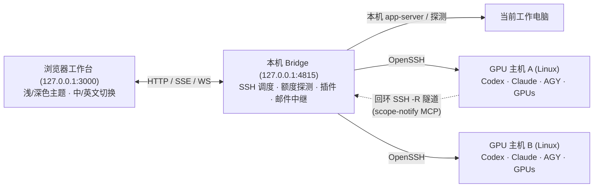

# SCOPE

[English](./README.md) | **简体中文**

[](./LICENSE)
[](https://nodejs.org/)

### **One monitor for all agent sessions.**
**用一个工作台，统一监控与驾驭本机及多台 SSH GPU 服务器上的所有编程 Agent 会话。**

当你同时在本地电脑和多台 Linux 训练机上运行 **Codex**、**Claude Code** 或 **Antigravity (`agy`)** 时，`tmux` 窗口、权限审批、后台子代理和账号剩余额度很快会散落一地。**SCOPE** 直接接入各主机上的原生会话目录，把实时流式对话、交互审批、远程文件预览、GPU 进程归属与订阅余量收进本机浏览器（`127.0.0.1`）。

---

## 核心特性

- **One monitor for all agent sessions**：零侵入扫描你在终端、VS Code 或 `tmux` 里启动过的原生会话（`~/.codex/sessions`、`~/.claude/projects`、`~/.gemini/antigravity-cli`），直接按原生会话 ID 续聊，不破坏 CLI 历史。
- **实时流式交互、审批与后台子代理**：支持 Codex、Claude Code 和 Antigravity 的文件修改/命令审批、交互问答卡片、运行中追加消息、模型/推理强度切换、安全中断，以及 **Claude Code / Antigravity 后台子代理实时工作状态** 追踪。
- **多 Agent 账号中心与实时 `/usage` 额度**：统一查看 **Codex**（多 Profile 池 + 故障自动切换 + 5h/周额度）、**Claude Code**（本地 OAuth 实时 5h/7d 额度）和 **Antigravity**（官方 `agy -p /usage --output-format json` 分组 5h/周额度）的登录与余量，并支持一键打开内置 Web SSH 终端登录/切换账号。
- **GPU 归属与会话并发池**：实时采集各主机 `nvidia-smi` 显存/利用率和训练进程树，自动关联到对应 Agent 会话；提供按主机的常驻会话并发池（`residentSessionsPerHost`）与会话 **保留（Pin）** 机制，避免重要长程任务被误回收。
- **跨项目总调度（Coordinator）**：只读汇总各主机状态、会话进展和 GPU 资源，在一个对话框里对比实验、定位异常或起草下一步任务。
- **本机优先、零硬编码密钥**：所有 SSH 主机、出口代理命令（`preLaunchCommand`）、SMTP 凭据、网关令牌与本地防泄漏词表全部存放在 Git 忽略的 `.scope/` 目录中。



---

## 快速开始

### 环境要求

- **控制端电脑**：Windows / macOS / Linux，已安装 **Node.js `>= 22.13`**、**Python 3** 和 **OpenSSH 客户端（`ssh`）**
- **远端主机**：Linux，已安装 **Python 3**、配置免密 SSH 登录（`BatchMode=yes` 可直连），Codex 托管会话建议安装 `tmux`
- **Agent CLI**：在目标机器上预先安装并登录对应工具（`codex`、`claude`、`agy` 或可选 `dsh`）

### 本机启动

```sh
git clone <本仓库地址> scope
cd scope
npm ci
npm run scope
```

打开 **http://localhost:3000/**。前端（`3000`）与 Bridge（`4815`）默认只监听 `127.0.0.1`。

1. 点击顶栏 **`EN / 中`** 可随时切换界面语言。
2. 进入 **设置 → 远程主机与部署**：按需配置每台主机的启动前命令（如出口代理或 Conda 初始化），并可一键部署远端 `scope-notify` 邮件通知服务。
3. 点击顶栏或 Claude/AGY 会话右上角的 **账号管理**，统一查看 Codex / Claude Code / Antigravity 登录态与实时剩余额度。

---

## Agent 能力矩阵

| 能力 | Codex | Claude Code | Antigravity (`agy`) | DSH |
| --- | --- | --- | --- | --- |
| 实时流式对话与原生续聊 | 支持（`app-server` 与本机） | 支持（`stream-json`） | 支持（`ACP`） | Headless 单次任务 |
| 网页审批与提问表单 | 支持 | 支持 | 支持 | — |
| 模型与推理强度切换 | 支持 | 支持 | 支持 | 由远端 profile 控制 |
| 订阅剩余额度实时查询（`/usage`） | 支持（5h/周 + 多账号） | 支持（5h/7d OAuth 实时用量） | 支持（分组 5h/周实时额度） | — |
| 后台子代理实时状态显示 | Rollout 子代理树 | 支持（实时 + `subagents/`） | 支持（ACP + 子会话日志） | — |
| `/` 命令与项目技能 | 支持（`skills/list` + `/compact`） | 支持（实时读取 CLI 命令） | 支持（ACP 会话命令） | — |
| 外部终端 / VS Code 会话观察 | 支持（只读观察） | 历史扫描 | 历史扫描 | — |
| 网页检查 / 安装 / 更新 CLI | 支持（含安全热切换） | 支持 | 支持版本检查 | 支持 |

---

## 可选本地配置

所有运行态数据——主机启动前命令、SMTP 凭据（`0600`）、远程隧道、网关密钥与已导入插件——全部存放在 Git 忽略的 `.scope/` 目录中：

- 如需开启实验任务队列（`taskQueue`）或预配置内置集群主机，可复制 `examples/deployment.example.json` 为 `.scope/deployment.json`。
- 如需在执行 `npm run export:opensource -- --check` 时拦截团队内网 IP、主机名或代号，可复制 `examples/leak-denylist.example.json` 为 `.scope/leak-denylist.json`。

---

## 完整文档导航

- **[完备部署指南](./docs/deployment.zh-CN.md)** — 本机模式、Linux `systemd --user` 常驻部署、Tailscale / 局域网 HTTPS 私有网关、代理与环境配置、并发池、多 Agent 额度、运维排障与安全清单
- **[插件接入与开发指南 (v1)](./docs/plugin-protocol.zh-CN.md)** — 从零编写、校验、安装、调用与卸载 SCOPE 插件的完整手册（含协议字段、生命周期、HTTP API、扩展新 Agent 说明）
- [快速上手速查](./docs/getting-started.zh-CN.md) — 精简版启动与 SSH 配置说明
- [多 Agent 会话、审批与账号管理](./docs/agents-and-sessions.zh-CN.md) — Codex 多账号故障切换、Claude/AGY 实时交互、附件上传与可逆归档
- [邮件通知与远端一键初始化](./docs/notifications-and-remote.zh-CN.md) — Web SMTP 预设、本地 `0600` 凭据与非 root 的 `scope-notify` 部署
- [架构说明](./docs/architecture.zh-CN.md) — 前后端目录与模块职责
- [贡献指南](./CONTRIBUTING.md) · [安全说明](./SECURITY.md)

---

## 本地校验

```sh
npm run typecheck
npm run build
npm run test:unit
npm run lint
npm run export:opensource -- --check
```

> 本地防泄漏词表（可选）：可复制 `examples/leak-denylist.example.json` 为 `.scope/leak-denylist.json`（已被 Git 忽略），在执行 `export:opensource -- --check` 时拦截团队内部 IP、主机名或代号。

## 开源协议

[MIT](./LICENSE)
