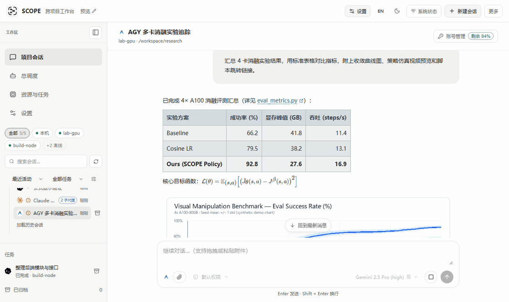
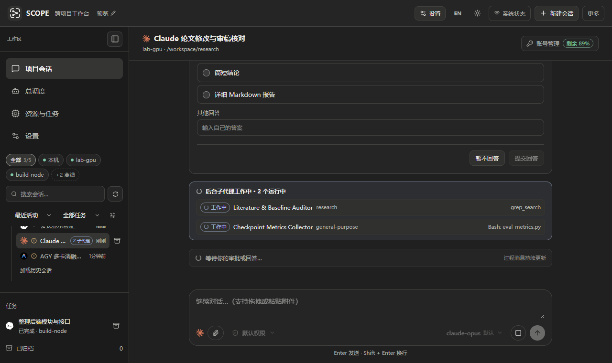
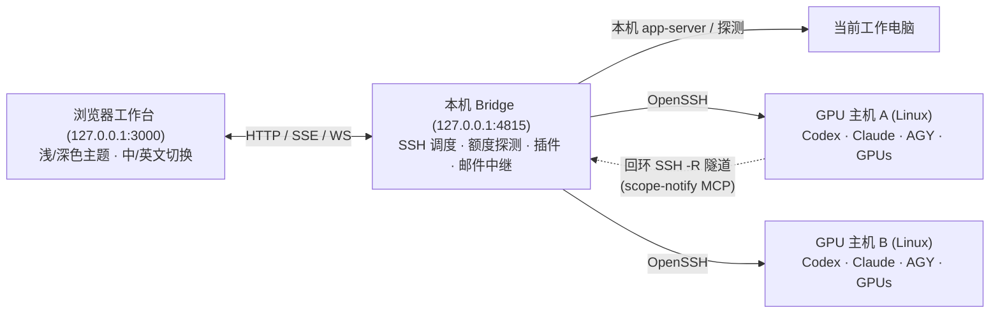

<p align="center">
  
</p>

<h1 align="center">SCOPE</h1>

<p align="center">
  <strong>One monitor for all agent sessions.</strong><br/>
  用一个本机优先的网页工作台，统一监控与驾驭本机及多台 Linux SSH GPU 服务器上的 <b>Codex</b>、<b>Claude Code</b> 与 <b>Antigravity (<code>agy</code>)</b> 会话。
</p>

<p align="center">
  <a href="https://github.com/securityCFS/SCOPE/blob/main/README.md">English</a> · <b>简体中文</b> ·
  <a href="https://github.com/securityCFS/SCOPE/blob/main/docs/deployment.zh-CN.md">完备部署指南</a> ·
  <a href="https://github.com/securityCFS/SCOPE/blob/main/docs/plugin-protocol.zh-CN.md">插件接入指南</a>
</p>

<p align="center">
  <a href="https://www.npmjs.com/package/@godchaser/scope"></a>
  <a href="https://github.com/securityCFS/SCOPE/blob/main/LICENSE"></a>
  <a href="https://nodejs.org/">= 22.13" /></a>
  
  
</p>

---

## 实机交互体验演示

<p align="center">
  
</p>

<p align="center">
  <sub>基于 <code>npm run preview:fixture</code> 隔离虚拟数据录制（零真实会话与隐私）：富媒体渲染（表格 · KaTeX 公式 · 内嵌图片与可播放视频 · <code>file://</code> 跳转）→ Claude 后台子代理与审批卡片 → 三 Agent <code>/usage</code> 实时额度中心 → 4× A100 GPU 负载 → 深色模式。</sub>
</p>

| 浅色模式（表格 · 公式 · 图片与视频内嵌预览） | 深色模式（后台子代理实时追踪 · 交互审批） |
| :---: | :---: |
|  |  |

---

## 核心特性

- **One monitor for all agent sessions**：零侵入扫描你在终端、VS Code 或 `tmux` 里启动过的原生会话（`~/.codex/sessions`、`~/.claude/projects`、`~/.gemini/antigravity-cli`），直接按原生会话 ID 续聊，不破坏原有 CLI 历史。
- **实时流式交互、审批与后台子代理**：支持 Codex、Claude Code 和 Antigravity 的文件修改/命令审批、交互问答卡片、运行中追加消息、模型/推理强度切换、安全中断，以及 **Claude Code / Antigravity 后台子代理实时工作状态** 追踪。
- **多 Agent 账号中心与实时 `/usage` 额度**：统一查看 **Codex**（多 Profile 池 + 故障自动切换 + 5h/周额度）、**Claude Code**（本地 OAuth 实时 5h/7d 额度）和 **Antigravity**（官方 `agy -p /usage --output-format json` 分组 5h/周额度）的登录态与余量，并支持一键打开内置 Web SSH 终端登录/切换账号。
- **GPU 归属与会话并发池**：实时采集各主机 `nvidia-smi` 显存/利用率和训练进程树，自动关联到对应 Agent 会话；提供按主机的常驻会话并发池（`residentSessionsPerHost`）与会话 **保留（Pin）** 机制，避免重要长程任务被误回收。
- **跨项目总调度（Coordinator）**：只读汇总各主机状态、会话进展和 GPU 资源，在一个对话框里对比实验、定位异常或起草下一步任务。
- **富媒体渲染与三端 SCOPE 协议一键注入**：原生支持 KaTeX 公式、GFM 表格、远端图片内嵌、HTML5 视频流式预览与 `file://` 行号跳转（全面兼容 Antigravity 的 `file://` 链接习惯），并支持一键向 `~/.codex/AGENTS.md`、`~/.claude/CLAUDE.md` 与 `~/.gemini/config/GEMINI.md` 注入规范协议。
- **独立 CLI 更新代理路径**：每台主机支持分别配置 Agent 对话运行代理（`preLaunchCommand`）与 CLI 版本检测/更新独立代理（`updatePreCommand`，如 `source ~/.pkg_proxy.sh` 或独立代理别名），互不干扰且支持 Codex 安全热升级。
- **本机优先、零硬编码密钥**：所有 SSH 主机、出口代理命令（`preLaunchCommand` / `updatePreCommand`）、SMTP 凭据、网关令牌与本地防泄漏词表全部存放在 Git 忽略的 `.scope/` 目录中。



---

## Agent 能力矩阵

<p align="center">
  
</p>

| 能力 | Codex | Claude Code | Antigravity (`agy`) | DSH |
| --- | --- | --- | --- | --- |
| 实时流式对话与原生续聊 | 支持（`app-server` 与本机） | 支持（`stream-json`） | 支持（`ACP`） | Headless 单次任务 |
| 网页审批与提问表单 | 支持 | 支持 | 支持 | — |
| 模型与推理强度切换 | 支持 | 支持 | 支持 | 由远端 profile 控制 |
| 订阅剩余额度实时查询（`/usage`） | 支持（5h/周 + 多账号） | 支持（5h/7d OAuth 实时用量） | 支持（分组 5h/周实时额度） | — |
| 后台子代理实时状态显示 | Rollout 子代理树 | 支持（实时 + `subagents/`） | 支持（ACP + 子会话日志） | — |
| `/` 命令与项目技能 | 支持（`skills/list` + `/compact`） | 支持（实时读取 CLI 命令） | 支持（ACP 会话命令） | — |
| 外部终端 / VS Code 会话观察 | 支持（只读观察） | 历史扫描 | 历史扫描 | — |
| 网页检查 / 安装 / 更新 CLI | 支持（含安全热切换） | 支持 | 支持版本检查 | 支持 |

---

## 快速开始

### 环境要求

- **控制端电脑**：Windows / macOS / Linux，已安装 **Node.js `>= 22.13`**、**Python 3** 和 **OpenSSH 客户端（`ssh`）**
- **远端主机**：Linux，已安装 **Python 3**、配置免密 SSH 登录（`BatchMode=yes` 可直连），Codex 托管会话建议安装 `tmux`
- **Agent CLI**：在目标机器上预先安装并登录对应工具（`codex`、`claude`、`agy` 或可选 `dsh`）

### 方式 A：通过 npm 包直接安装运行（推荐）

```sh
# 全局安装
npm install -g @godchaser/scope
scope

# 或无需克隆直接运行
npx @godchaser/scope
# 免配 SSH 立即体验完整交互预览：
npx @godchaser/scope preview
```

### 方式 B：克隆源码启动

```sh
git clone https://github.com/securityCFS/SCOPE.git scope
cd scope
npm ci
npm run scope
```

打开 **http://localhost:3000/**。前端（`3000`）与 Bridge（`4815`）默认只监听 `127.0.0.1`。

> 想先免配 SSH 体验完整界面？直接运行 `npm run preview:fixture`（或 `scope preview`），然后访问 `http://127.0.0.1:3001/`。

---

## 可选本地配置

所有运行态数据——主机启动前命令、SMTP 凭据（`0600`）、远程隧道、网关密钥与已导入插件——全部存放在 Git 忽略的 `.scope/` 目录中：

- 如需开启实验任务队列（`taskQueue`）或预配置内置集群主机，可复制 `examples/deployment.example.json` 为 `.scope/deployment.json`。
- 如需在执行 `npm run export:opensource -- --check` 时拦截团队内网 IP、主机名或代号，可复制 `examples/leak-denylist.example.json` 为 `.scope/leak-denylist.json`。

---

## 完整文档导航

- **[完备部署指南](https://github.com/securityCFS/SCOPE/blob/main/docs/deployment.zh-CN.md)** — 本机模式、Linux `systemd --user` 常驻部署、Tailscale / 局域网 HTTPS 私有网关、代理与环境配置、并发池、多 Agent 额度、运维排障与安全清单
- **[插件接入与开发指南 (v1)](https://github.com/securityCFS/SCOPE/blob/main/docs/plugin-protocol.zh-CN.md)** — 从零编写、校验、安装、调用与卸载 SCOPE 插件的完整手册（含协议字段、生命周期、HTTP API、扩展新 Agent 说明）
- [快速上手速查](https://github.com/securityCFS/SCOPE/blob/main/docs/getting-started.zh-CN.md) — 精简版启动与 SSH 配置说明
- [多 Agent 会话、审批与账号管理](https://github.com/securityCFS/SCOPE/blob/main/docs/agents-and-sessions.zh-CN.md) — Codex 多账号故障切换、Claude/AGY 实时交互、附件上传与可逆归档
- [邮件通知与远端一键初始化](https://github.com/securityCFS/SCOPE/blob/main/docs/notifications-and-remote.zh-CN.md) — Web SMTP 预设、本地 `0600` 凭据与非 root 的 `scope-notify` 部署
- [架构说明](https://github.com/securityCFS/SCOPE/blob/main/docs/architecture.zh-CN.md) — 前后端目录与模块职责
- [贡献指南](https://github.com/securityCFS/SCOPE/blob/main/CONTRIBUTING.md) · [安全说明](https://github.com/securityCFS/SCOPE/blob/main/SECURITY.md)

---

## 路线图（Roadmap）

目前 SCOPE 仅初步完成了多 Agent 统一监控框架、原生会话接管、富媒体渲染与本机优先 SSH 工作台的基础能力，后续重点 TODO 包括：

- [ ] **自定义云服务器多端控制方案（如手机端控制）**：提供可自建的云服务器中继与移动端友好交互方案，随时随地通过手机、平板安全查看任务进度、审批高风险操作并向 Agent 追加指令。
- [ ] **主界面与工作台高度自定义**：支持自定义首页布局、主题风格、快捷看板、置顶模块与插件自定义视图，按团队或个人科研/研发习惯灵活编排界面。
- [ ] **更多 IDE 与编辑器深度联动**：在现有 VS Code Remote SSH 跳转之外，扩展支持 Cursor、Windsurf、JetBrains Gateway、Zed、Neovim 等主流 IDE/编辑器的双向联动。
- [ ] **更多 Agent 后端与集群插件生态**：持续接入更多编程 Agent、Slurm / Kubernetes / Ray 等集群调度器插件，以及 Webhook、飞书、钉钉、Slack、Telegram 等多渠道推送。

---

## 欢迎参与贡献（Contributing）

非常欢迎大家提 **Issue**、提交 **PR** 和参与社区共建！无论是反馈 Bug、提出新场景需求、贡献插件/新 IDE 适配，还是完善文档：

- 提交 Bug 或功能建议：[GitHub Issues](https://github.com/securityCFS/SCOPE/issues)
- 参与代码或文档贡献：[Pull Requests](https://github.com/securityCFS/SCOPE/pulls)（请参考 [CONTRIBUTING.md](https://github.com/securityCFS/SCOPE/blob/main/CONTRIBUTING.md)）
- 如果 SCOPE 帮到了你，欢迎点个 Star 支持项目持续演进！

---

## 本地校验

```sh
npm run typecheck
npm run build
npm run test:unit
npm run lint
npm run export:opensource -- --check
```

## 开源协议

[MIT](https://github.com/securityCFS/SCOPE/blob/main/LICENSE)
