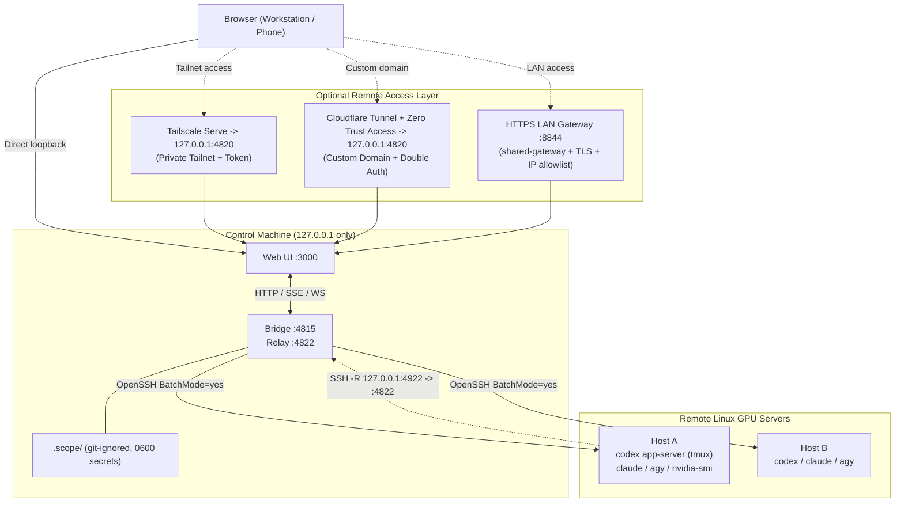

# SCOPE Deployment Guide

[English](./deployment.md) | [简体中文](./deployment.zh-CN.md)

> **SCOPE — One monitor for all agent sessions.**  
> This guide covers everything needed to deploy, configure, secure, operate, and troubleshoot SCOPE on a personal workstation, a persistent Linux server, or behind a private remote gateway.

---

## 1. Architecture & Network Boundaries

SCOPE is a **local-first, single-operator control plane**. It deliberately separates the browser UI from SSH execution and secret storage:

| Component | Default Bind | Purpose |
| --- | --- | --- |
| **Web UI** (`bridge/ui-server.mjs`) | `127.0.0.1:3000` | Production Next.js / `vinext` web workbench |
| **Bridge Server** (`bridge/server.mjs`) | `127.0.0.1:4815` | HTTP / SSE / WebSocket API, SSH multiplexer, quota probes, plugin host, scheduler |
| **Notification Relay** (inside Bridge) | `127.0.0.1:4822` | Authenticated loopback relay receiving remote `scope-notify` events over SSH `-R` tunnels |
| **Private Gateway** (`bridge/private-start.mjs`) | `127.0.0.1:4820` | Token-authenticated proxy for Tailscale Serve or Cloudflare Tunnel + Zero Trust Access (incl. `/scope-port/<port>/` proxy) |
| **Shared LAN Gateway** (`bridge/shared-start.mjs`) | Configured LAN IP (e.g. `:8844`) | Optional HTTPS proxy with strict client IP allowlist + bearer token |



**Security rule**: Never bind ports `3000` or `4815` directly to `0.0.0.0` or expose them to the public internet.

---

## 2. Prerequisites

### Control Machine (Runs SCOPE)
- **OS**: Windows 10/11, macOS 13+, or Linux
- **Node.js**: `>= 22.13.0` (`node -v`)
- **Python 3**: Required for local session catalog & auth probes (`python3` on macOS/Linux, `python` or `py -3` on Windows)
- **OpenSSH Client**: `ssh` (`ssh.exe` on Windows) on `PATH`

### Remote Servers (Monitored Targets)
- **OS**: Linux (x86_64 or arm64)
- **SSH**: Key-based authentication with zero interactive prompts (`BatchMode=yes`, `StrictHostKeyChecking=yes`—populate `~/.ssh/known_hosts` once beforehand)
- **Python 3**: Required for remote probes, interactive workers, and `scope-notify`
- **`tmux`**: Required for durable Codex `app-server` sessions that survive browser/Bridge restarts
- **`nvidia-smi`** *(optional)*: Automatically used for live GPU memory/utilization and training process matching
- **Agent CLIs**: Install and authenticate the agents you use on each target host (`codex`, `claude`, `agy`)

Verify SSH readiness from your control machine before starting SCOPE:

```sh
ssh -T -o BatchMode=yes -o StrictHostKeyChecking=yes -o ConnectTimeout=5 <host-alias> "python3 --version && command -v tmux"
```

---

## 3. Deployment Topologies

### Topology A: Local Workstation (Recommended Default)

Best when your laptop/desktop already holds your SSH keys and `~/.ssh/config`.

```sh
git clone https://github.com/securityCFS/SCOPE.git scope
cd scope
npm ci
npm run scope
```

`npm run scope` builds the production UI and starts both the Bridge (`127.0.0.1:4815`) and UI (`127.0.0.1:3000`) under one supervisor (`bridge/start.mjs`).

- **Already built? Skip rebuild on restart**:
  ```sh
  node bridge/start.mjs --skip-build
  ```
- **Development hot-reload mode**:
  ```sh
  npm run scope:dev
  ```
- **Windows background launch (no console window)**:
  ```powershell
  npm run build
  Start-Process -WindowStyle Hidden -WorkingDirectory (Get-Location) -FilePath (Get-Command node).Source -ArgumentList "bridge/start.mjs","--skip-build"
  ```

---

### Topology B: Persistent Linux Server (`systemd --user`)

Best when you want SCOPE running 24/7 on a Linux jump host, VPS, or lab workstation.

**Via npm CLI (no git clone required):**

```sh
npm install -g @godchaser/scope
scope service install --with-gateway
loginctl enable-linger "$USER"
scope service status
```

**Or from a source checkout:**

```sh
git clone https://github.com/securityCFS/SCOPE.git scope
cd scope
bash scripts/install-remote-server.sh
```

Keep the user service alive after SSH logout:

```sh
loginctl enable-linger "$USER"
systemctl --user status scope-workbench.service
journalctl --user -u scope-workbench.service -f
```

Access safely from your laptop over SSH:

```sh
ssh -N -L 3000:127.0.0.1:3000 -L 4815:127.0.0.1:4815 <jump-host>
```

Then open **http://127.0.0.1:3000/** locally.

---

### Topology C: Remote / Mobile Access Gateways

> For the full step-by-step phone & custom-domain walkthrough (including Cloudflare Zero Trust Access policy setup and `/scope-port/<port>/` remote dev server proxying), see the **[Remote & Mobile Access Guide](./remote-access.md)**.

#### Option C1: Tailscale Serve (2-Minute Private Tailnet Access)

```sh
npm install -g @godchaser/scope
scope start --gateway             # Starts UI (:3000) + Bridge (:4815) + Private Gateway (:4820)
scope expose tailscale            # Runs `tailscale serve --bg --https=443 http://127.0.0.1:4820`
scope token --show                # View or rotate (`--rotate`) the 0600 gateway secret
```

- **Important**: Always use `tailscale serve` (private to your tailnet), **never** `tailscale funnel`.

#### Option C2: Custom Domain via Cloudflare Named Tunnel + Zero Trust Access

```sh
npm install -g @godchaser/scope
cloudflared tunnel login
scope expose cloudflare --domain scope.yourdomain.com --tunnel scope-hub
scope service install --with-gateway --with-cloudflared --tunnel scope-hub
loginctl enable-linger "$USER"
scope token --url https://scope.yourdomain.com
```

- Routes `https://scope.yourdomain.com` strictly to `http://127.0.0.1:4820` with **zero open inbound server ports**.
- Pair with **Cloudflare Zero Trust Access** (Self-hosted application with **Emails-only** `Include` rule; never place `Login Methods` inside `Include` since `Include` rules are OR'd).
- Supports authenticated `/scope-port/<port>/` HTTP + WebSocket proxying for allowlisted `@local` and SSH-forwarded dev servers.

#### Option C3: Restricted LAN HTTPS Gateway (TLS + Client IP Allowlist)

1. Generate or place a TLS certificate and private key inside `.scope/shared-access/`:
   ```sh
   mkdir -p .scope/shared-access
   openssl req -x509 -newkey rsa:2048 -nodes \
     -keyout .scope/shared-access/server.key \
     -out .scope/shared-access/server.crt \
     -days 365 -subj "/CN=scope-lan"
   ```
2. Create `.scope/shared-access/config.json` with an **explicit non-wildcard local IP** and **explicit client IP allowlist**:
   ```json
   {
     "host": "192.168.1.50",
     "port": 8844,
     "allowedClients": ["192.168.1.60", "192.168.1.61"]
   }
   ```
   > Note: `0.0.0.0`, `::`, empty `allowedClients`, or ports `< 1024` are rejected at startup.
3. Start the gateway:
   ```sh
   npm run shared-gateway
   ```
4. Retrieve the generated access token from `.scope/shared-access/access.json`. Unlisted client IPs receive `403`; unauthenticated requests receive `401`.

---

## 4. Essential Post-Deployment Configuration

### 4.1 SSH Host Discovery
SCOPE reads `~/.ssh/config` (override via `SCOPE_SSH_CONFIG`). Explicit `Host <alias>` blocks are discovered automatically; wildcard patterns (`Host *`, `Host *.example.com`) are ignored. Unreachable hosts collapse neatly in both the sidebar and Resource overview.

### 4.2 Outbound Proxy, Conda & PATH Setup (`preLaunchCommand`)
SCOPE ships with **zero hardcoded proxy commands**. If a remote GPU host requires an HTTP/SOCKS proxy, custom `PATH`, or Conda environment before contacting LLM APIs:

1. Open **Settings → Hosts & Remote Deploy**.
2. Pick the target host and enter **Pre-launch command**, e.g.:
   ```sh
   export https_proxy=http://127.0.0.1:7890 http_proxy=http://127.0.0.1:7890
   ```
   or:
   ```sh
   source ~/.proxy_env
   ```
3. Click **Save host setup**.
4. *(Optional)* Override per agent under **Settings → Agents & Accounts** (leaving blank inherits the host setting).

**Fail-closed guarantee**: If a configured `preLaunchCommand` exits non-zero, SCOPE aborts the launch/probe immediately rather than silently leaking requests over a direct connection.

### 4.3 Session Concurrency Pool & Retention
Under **Settings → General & Coordinator** (or per host under **Hosts & Remote Deploy**):
- **`residentSessionsPerHost`** (default `5`, range `0..64`): Idle managed Codex sessions below this per-host pool limit stay resident indefinitely.
- **`sessionIdleGraceMinutes`** (default `15`, range `1..1440`): Only when idle sessions exceed the pool limit are the oldest idle sessions retired (FIFO) after this grace period.
- **Pin / Reserve**: Mark any critical session (e.g., long-running experiments or timer-based tasks) as **Reserved** in the sidebar/header to exempt it from automatic retirement.

### 4.4 Multi-Agent Login & Live Quota Setup (`/usage`)
Open **Accounts** from the topbar (or inside any Claude/AGY conversation header):
- **Codex**: Supports local `~/.codex/auth.json` + live quota, and on remote SSH hosts supports multi-profile saving, browser Device Auth login, automatic failover, and per-profile 5h / 7d remaining quota.
- **Claude Code**: Detects `claude auth status` (multi-line JSON) and reads live **5h session**, **7d weekly**, and per-model weekly quotas via the official zero-token command `claude -p /usage --output-format json --no-session-persistence --strict-mcp-config` through the host's configured `preLaunchCommand`. SCOPE never reads Claude credential files or the macOS keychain; the unmodified Claude Code binary reports its own usage. Use **Open SSH Terminal** for one-click `claude auth login`.
- **Antigravity (`agy`)**: Detects `~/.gemini/antigravity-cli/antigravity-oauth-token` metadata and `settings.json`, and reads live grouped **5h / weekly** remaining quotas (e.g., Gemini Models & Claude/GPT Models) via the official zero-token command `agy -p /usage --output-format json` through the host's configured `preLaunchCommand`.

### 4.5 Email Notifications & One-Click Remote `scope-notify`
1. Configure local SMTP under **Settings → Email & Notifications** (presets for Gmail, Outlook/365, QQ Mail, 163 Mail, Feishu/Lark, or custom SMTP). Credentials stay on your control machine in `.scope/email-smtp-secret.json` (`0600`).
2. Under **Settings → Hosts & Remote Deploy** (or via `npm run remote:bootstrap -- deploy <ssh-host>`), click **One-click deploy**:
   - Opens a loopback-only reverse tunnel (`-R 127.0.0.1:4922:127.0.0.1:4822`) back to the local relay.
   - Installs `~/.local/bin/scope-notify` (works for non-root users) with a scoped bearer token—never your SMTP password.
   - Registers the `scope-email` MCP tool for Codex and Claude Code.

### 4.6 Optional Configuration Files (`.scope/`)
- **`.scope/deployment.json`** (copy from `examples/deployment.example.json`):
  - `taskQueue`: Enable experimental cross-host task queue (`false` by default).
  - `dlcHostname`: Optional initial SSH host for the built-in Aliyun DLC monitor.
  - `proxyBootstrapHosts`: Optional aliases that run `SCOPE_HOST_BOOTSTRAP_COMMAND` on first discovery.
  - `emailTunnelHost`: Legacy single-host tunnel fallback.
- **`.scope/persistent-codex-homes.json`**: Map host aliases to expected persistent volume paths (e.g. `{"gpu-a": "/mnt/storage/codex-home"}`) so SCOPE refuses to start Codex if a symlinked volume drops.
- **`.scope/leak-denylist.json`** (copy from `examples/leak-denylist.example.json`): Private patterns checked locally by `npm run export:opensource -- --check`.

---

## 5. Environment Variables Reference

| Variable | Default | Purpose |
| --- | --- | --- |
| `SCOPE_UI_PORT` | `3000` | Loopback Web UI port |
| `SCOPE_BRIDGE_PORT` | `4815` | Loopback Bridge API port |
| `SCOPE_PRIVATE_PORT` | `4820` | Loopback Private Access Gateway port |
| `SCOPE_STATE_DIR` | `./.scope` or `~/.scope` | Directory storing local state & `0600` secrets |
| `SCOPE_WITH_GATEWAY` | *(unset)* | Set to `1` to launch Private Gateway alongside UI + Bridge |
| `SCOPE_SSH_CONFIG` | `~/.ssh/config` | Custom SSH config file path |
| `SCOPE_HOST_BOOTSTRAP_COMMAND` | *(unset)* | Optional command for hosts listed in `.scope/deployment.json` `proxyBootstrapHosts` |
| `SCOPE_EMAIL_SMTP_USER` / `SCOPE_EMAIL_SMTP_PASS` | *(unset)* | Override local `.scope/email-smtp-secret.json` SMTP credentials |
| `SCOPE_SYSTEMD_SERVICE` | `scope-workbench` | Custom `systemd --user` service unit name in `install-remote-server.sh` |
| `SCOPE_EXPORT_DENYLIST` | `.scope/leak-denylist.json` | Custom JSON denylist path for `npm run export:opensource -- --check` |

---

## 6. Operations, Upgrades & Backups

### Upgrading SCOPE
```sh
git pull --ff-only
npm ci
npm run build
# Restart your supervisor / systemd service:
systemctl --user restart scope-workbench.service   # Linux systemd
# or restart `npm run scope` / `node bridge/start.mjs --skip-build`
```
> Managed remote Codex `app-server` sessions run in detached `tmux` sockets (`scope-app-server-*`) and **stay alive across SCOPE restarts**.

### Health Checks
- Web UI: `curl -fsS http://127.0.0.1:3000/ >/dev/null`
- Bridge API: `curl -fsS http://127.0.0.1:4815/api/health`
- Provider auth & quota: `curl -fsS "http://127.0.0.1:4815/api/auth/providers?host=%40local"`

### What to Back Up
All persistent runtime state resides in `.scope/` (never commit it to Git):
- `.scope/state.json` — Host runtime configs, session pins/summaries/display names
- `.scope/workbench.json` — Coordinator, scheduler concurrency pool, and provider settings
- `.scope/email-notifications.json` & `.scope/email-smtp-secret.json` — Notification rules & SMTP secret
- `.scope/plugin-data/` & `.scope/extensions/` — Installed local plugins & plugin configs

---

## 7. Troubleshooting

| Symptom | Likely Cause | Resolution |
| --- | --- | --- |
| Remote host shows **Offline / Auth failed** | Interactive passphrase or unverified host key | Test `ssh -T -o BatchMode=yes -o StrictHostKeyChecking=yes <host> true`; load SSH agent key and accept host key once |
| Claude or AGY quota times out | Host requires proxy to reach Anthropic / Google | Set **Pre-launch command** under **Settings → Hosts & Remote Deploy** and click **Refresh** in **Accounts** |
| Claude quota shows `未找到订阅额度` | Claude Code uses API-key billing, or the installed version predates `/usage` | Run `claude -p /usage` on the host; update Claude Code or re-run `claude auth login` in the built-in SSH terminal |
| Port `3000` or `4815` already occupied | Previous `bridge/start.mjs` supervisor still running | Stop the supervisor process first (so it doesn't respawn children), then start `node bridge/start.mjs --skip-build` |
| `npm run build` fails on Node 20 | Node.js below minimum version | Upgrade to Node.js `>= 22.13` (`nvm use 22`) |

---

## 8. Pre-Deployment Security Checklist

- [ ] Ports `3000`, `4815`, `4820`, and `4822` listen on `127.0.0.1` only.
- [ ] Remote access uses SSH port forwarding, Tailscale **Serve** (never Funnel), Cloudflare Named Tunnel + Zero Trust Access (Emails-only `Include`), or `shared-gateway` with TLS + strict `allowedClients`.
- [ ] `.scope/` is git-ignored and secret files keep `0600` permissions.
- [ ] Only audited plugins are installed under `.scope/extensions/`.
- [ ] `npm run export:opensource -- --check` passes before pushing any fork or contribution.
