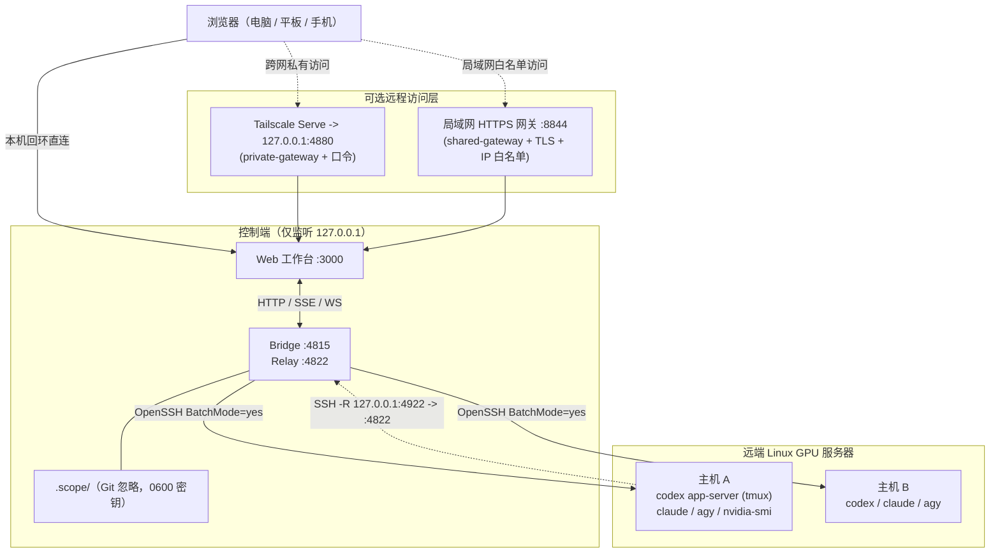

# SCOPE 完备部署指南

[English](./deployment.md) | [简体中文](./deployment.zh-CN.md)

> **SCOPE — One monitor for all agent sessions.**  
> 本文档提供 SCOPE 在本机工作站、Linux 常驻服务器及私有远程访问网关场景下的完整部署、配置、运维、排障与安全清单。

---

## 1. 架构与网络边界

SCOPE 采用 **本机优先、单操作者控制面** 架构，将浏览器界面、SSH 调度与敏感凭据严格隔离：

| 组件 | 默认监听地址 | 职责 |
| --- | --- | --- |
| **Web 工作台** (`bridge/ui-server.mjs`) | `127.0.0.1:3000` | 生产环境 Next.js / `vinext` 前端页面 |
| **Bridge 服务** (`bridge/server.mjs`) | `127.0.0.1:4815` | HTTP / SSE / WebSocket API、SSH 调度、额度探测、插件宿主、任务并发池 |
| **本地通知中继**（内置于 Bridge） | `127.0.0.1:4822` | 接收远端 `scope-notify` 通过 SSH `-R` 隧道回传的完成/异常通知 |
| **Tailscale 私有网关** (`bridge/private-start.mjs`) | `127.0.0.1:4880` | 可选口令鉴权代理，配合 Tailscale Serve 使用 |
| **局域网共享网关** (`bridge/shared-start.mjs`) | 指定内网 IP（如 `:8844`） | 可选 HTTPS 代理，强制来源 IP 白名单 + 访问口令 |



**安全底线**：严禁将 `3000` 或 `4815` 端口直接绑定到 `0.0.0.0` 或暴露到公网。

---

## 2. 环境前置条件

### 控制端（运行 SCOPE 的机器）
- **操作系统**：Windows 10/11、macOS 13+ 或 Linux
- **Node.js**：`>= 22.13.0`（使用 `node -v` 检查）
- **Python 3**：用于本机会话目录与账号/额度探测（macOS/Linux 为 `python3`，Windows 为 `python` 或 `py -3`）
- **OpenSSH 客户端**：`ssh`（Windows 为 `ssh.exe`）已在 `PATH` 中

### 远端主机（被监控的 GPU / 开发机）
- **操作系统**：Linux（x86_64 / arm64）
- **SSH 免密登录**：支持非交互密钥登录（`BatchMode=yes` 且 `StrictHostKeyChecking=yes`，首次连接需将主机指纹写入 `~/.ssh/known_hosts`）
- **Python 3**：用于远端会话扫描、交互式 worker 及 `scope-notify`
- **`tmux`**：Codex 持久 `app-server` 托管会话所必需（重启 SCOPE 或关闭浏览器不中断远端会话）
- **`nvidia-smi`**（可选）：自动采集显存、利用率与训练进程树
- **Agent CLI**：在需要运行任务的机器上安装并完成登录（`codex`、`claude`、`agy`）

启动 SCOPE 前，建议先在控制端执行连通性自检：

```sh
ssh -T -o BatchMode=yes -o StrictHostKeyChecking=yes -o ConnectTimeout=5 <主机别名> "python3 --version && command -v tmux"
```

---

## 3. 三种部署模式

### 模式 A：本机控制端模式（推荐日常使用）

适合 SSH 私钥与 `~/.ssh/config` 就在日常笔记本/台式机上的场景。

```sh
git clone https://github.com/securityCFS/SCOPE.git scope
cd scope
npm ci
npm run scope
```

`npm run scope` 会自动构建生产前端并由守护进程（`bridge/start.mjs`）拉起 Bridge（`127.0.0.1:4815`）与 UI（`127.0.0.1:3000`）。

- **已构建过前端、快速重启**：
  ```sh
  node bridge/start.mjs --skip-build
  ```
- **前端开发热更新模式**：
  ```sh
  npm run scope:dev
  ```
- **Windows 无窗口后台常驻启动**：
  ```powershell
  npm run build
  Start-Process -WindowStyle Hidden -WorkingDirectory (Get-Location) -FilePath (Get-Command node).Source -ArgumentList "bridge/start.mjs","--skip-build"
  ```

---

### 模式 B：Linux 服务器常驻部署（`systemd --user`）

适合把 SCOPE 长期部署在跳板机或实验室 Linux 主机上，随时从任意电脑通过 SSH 端口转发访问。

```sh
git clone https://github.com/securityCFS/SCOPE.git scope
cd scope
bash scripts/install-remote-server.sh
```

脚本会自动完成：
1. 检查 Node.js `>= 22.13` 与 `python3`。
2. 执行 `npm ci` 与 `npm run build`。
3. 写入并启动 `~/.config/systemd/user/scope-workbench.service`（运行 `node bridge/start.mjs --skip-build`，仍只监听 `127.0.0.1`）。
4. 若当前环境未启用 `systemd --user`（如容器内），自动打印 `nohup` 后台启动命令。

确保退出 SSH 后服务不停止，并查看运行状态：

```sh
loginctl enable-linger "$USER"
systemctl --user status scope-workbench.service
journalctl --user -u scope-workbench.service -f
```

在自己电脑上通过 SSH 隧道安全访问：

```sh
ssh -N -L 3000:127.0.0.1:3000 -L 4815:127.0.0.1:4815 <跳板机别名>
```

然后在本地浏览器打开 **http://127.0.0.1:3000/**。

---

### 模式 C：远程 / 手机 / 局域网安全访问网关

#### 方案 C1：Tailscale Serve（推荐跨网 / 手机端访问）

```sh
npm run scope
npm run private-gateway
tailscale serve --bg http://127.0.0.1:4880
```

- `bridge/private-start.mjs` 在 `127.0.0.1:4880` 启动带口令校验的网关，并在 `.scope/private-access.json`（`0600`）生成随机访问口令。
- **重要**：请仅使用 Tailnet 内部可见的 `tailscale serve`，切勿使用公开到公网的 `tailscale funnel`。

#### 方案 C2：局域网 HTTPS + 来源 IP 白名单网关

1. 在 `.scope/shared-access/` 放入自签或内网证书 `server.crt`、`server.key`：
   ```sh
   mkdir -p .scope/shared-access
   openssl req -x509 -newkey rsa:2048 -nodes \
     -keyout .scope/shared-access/server.key \
     -out .scope/shared-access/server.crt \
     -days 365 -subj "/CN=scope-lan"
   ```
2. 创建 `.scope/shared-access/config.json`，指定**具体内网网卡 IP** 与**显式客户端 IP 白名单**：
   ```json
   {
     "host": "192.168.1.50",
     "port": 8844,
     "allowedClients": ["192.168.1.60", "192.168.1.61"]
   }
   ```
   > 安全校验：禁止绑定 `0.0.0.0` / `::`，禁止空 `allowedClients`，端口必须在 `1024..65535`。
3. 启动共享网关：
   ```sh
   npm run shared-gateway
   ```
4. 在 `.scope/shared-access/access.json` 查看自动生成的访问口令。非白名单来源直接返回 `403`，未登录返回 `401`。

---

## 4. 部署后关键配置

### 4.1 SSH 主机发现与离线折叠
SCOPE 自动读取 `~/.ssh/config`（可通过 `SCOPE_SSH_CONFIG` 覆盖），忽略 `Host *` 等通配符段。不可达主机在左侧栏与「资源与任务」页均默认折叠，不影响浏览在线设备。

### 4.2 出口代理、Conda 与环境变量（`preLaunchCommand`）
开源版没有任何硬编码代理脚本，默认全部直连。若某些 GPU 主机访问模型 API 需要代理或环境初始化：

1. 进入 **设置 → 远程主机与部署**。
2. 选中目标主机，在 **启动前命令（Pre-launch command）** 填写你的初始化命令，例如：
   ```sh
   export https_proxy=http://127.0.0.1:7890 http_proxy=http://127.0.0.1:7890
   ```
   或：
   ```sh
   source ~/.proxy_env
   ```
3. 点击 **保存主机环境**。
4. 如需为单个 Agent 单独覆盖，在 **设置 → Agent 与账号** 中填写该 Agent 的专属启动前命令（留空自动继承主机配置）。

**失败即停（Fail-closed）**：只要启动前命令返回非零退出码，SCOPE 会立即中止启动或探测，绝不静默降级为直连。

### 4.3 设备常驻并发池与会话保留
在 **设置 → 常规与总调度**（或单台主机配置）中调整：
- **`residentSessionsPerHost`**（默认 `5`，范围 `0..64`）：每台设备低于该数量的空闲托管 Codex 会话可常驻不关闭。
- **`sessionIdleGraceMinutes`**（默认 `15`，范围 `1..1440`）：仅当空闲会话超出并发池上限时，按先后顺序（FIFO）回收超过宽限期的旧空闲会话。
- **保留资源（Pin / Reserve）**：对设置了定时任务或长程评测的会话点击 **保留**，彻底免受自动回收。

### 4.4 多 Agent 账号登录与实时 `/usage` 额度
点击顶栏（或 Claude / AGY 会话右上角）的 **账号管理**：
- **Codex**：本机自动读取 `~/.codex/auth.json` 与额度；远端主机支持多账号 Profile 保存、Device Auth 登录、配额耗尽自动故障切换及逐账号 5h/周额度查询。
- **Claude Code**：支持多行 `claude auth status` 解析，并通过目标主机本地 `~/.claude/.credentials.json` OAuth 凭据（沿用主机 `preLaunchCommand`）实时查询 **5 小时会话额度** 与 **7 天周额度**（令牌不出目标主机）。远端支持一键打开 Web SSH 终端执行 `claude auth login`。
- **Antigravity (`agy`)**：读取 `~/.gemini/antigravity-cli/antigravity-oauth-token` 元数据与 `settings.json`，并通过目标主机官方零 Token 消耗命令 `agy -p /usage --output-format json`（沿用主机 `preLaunchCommand`）实时查询各模型分组（如 Gemini Models、Claude & GPT Models）的 **5 小时与周剩余额度**。

### 4.5 邮件通知与远端一键 `scope-notify`
1. 在 **设置 → 邮件与通知** 中选择邮箱预设（Gmail / Outlook / QQ / 163 / 飞书等）或自定义 SMTP；密钥仅以 `0600` 权限保存在本机 `.scope/email-smtp-secret.json`，永不上传至远端服务器。
2. 在 **设置 → 远程主机与部署** 点击 **一键部署**（或运行 `npm run remote:bootstrap -- deploy <主机别名>`）：
   - 建立回环 SSH `-R 127.0.0.1:4922:127.0.0.1:4822` 反向隧道；
   - 无 `root` 权限安装 `~/.local/bin/scope-notify` 与作用域令牌；
   - 自动为 Codex 和 Claude Code 注册 `scope-email` MCP 通知工具。

### 4.6 可选配置文件（`.scope/`）
- **`.scope/deployment.json`**（参考 `examples/deployment.example.json`）：按需开启 `taskQueue` 实验队列、`dlcHostname` 或 `proxyBootstrapHosts`。
- **`.scope/persistent-codex-homes.json`**：将主机别名映射到持久化存储路径（如 `{"gpu-a": "/mnt/storage/codex-home"}`），防止云盘掉挂载时误写入临时容器盘。
- **`.scope/leak-denylist.json`**（参考 `examples/leak-denylist.example.json`）：自定义本地敏感词表，配合 `npm run export:opensource -- --check` 防止误提交内网 IP 或代号。

---

## 5. 环境变量一览

| 变量名 | 默认值 | 说明 |
| --- | --- | --- |
| `SCOPE_SSH_CONFIG` | `~/.ssh/config` | 自定义 SSH 配置文件路径 |
| `SCOPE_HOST_BOOTSTRAP_COMMAND` | *（空）* | 首次发现 `proxyBootstrapHosts` 主机时执行的默认引导命令 |
| `SCOPE_EMAIL_SMTP_USER` / `SCOPE_EMAIL_SMTP_PASS` | *（空）* | 覆盖本地 `.scope/email-smtp-secret.json` 的 SMTP 账号密码 |
| `SCOPE_SYSTEMD_SERVICE` | `scope-workbench` | `install-remote-server.sh` 注册的 `systemd --user` 服务名 |
| `SCOPE_EXPORT_DENYLIST` | `.scope/leak-denylist.json` | `export:opensource -- --check` 读取的本地自定义敏感词表路径 |

---

## 6. 升级、健康检查与备份

### 升级版本
```sh
git pull --ff-only
npm ci
npm run build
# 重启常驻服务：
systemctl --user restart scope-workbench.service   # Linux systemd
# 或重启 `npm run scope` / `node bridge/start.mjs --skip-build`
```
> 远端 Codex 托管会话运行在独立 `tmux` socket（`scope-app-server-*`）中，**重启 SCOPE 不会中断正在运行的任务**，重连后自动恢复。

### 健康检查端点
- 前端：`curl -fsS http://127.0.0.1:3000/ >/dev/null`
- Bridge：`curl -fsS http://127.0.0.1:4815/api/health`
- 多 Agent 登录与额度：`curl -fsS "http://127.0.0.1:4815/api/auth/providers?host=%40local"`

### 建议备份的数据（仅保留在本地，勿提交 Git）
- `.scope/state.json`：主机环境配置、会话保留标记、自定义标题与摘要
- `.scope/workbench.json`：总调度设置、并发池与 Agent 配置
- `.scope/email-notifications.json` 与 `.scope/email-smtp-secret.json`：通知配置与本地 SMTP 授权码
- `.scope/extensions/` 与 `.scope/plugin-data/`：已导入插件包与插件配置

---

## 7. 常见排障

| 现象 | 常见原因 | 排查方式 |
| --- | --- | --- |
| 主机显示 **离线 / 认证失败** | SSH 需要输入密码或主机指纹未确认 | 执行 `ssh -T -o BatchMode=yes -o StrictHostKeyChecking=yes <主机> true` 确认免密且已写入 `known_hosts` |
| Claude / AGY 额度查询超时 | 远端主机访问官方 API 需要出口代理 | 在 **设置 → 远程主机与部署** 配置 `preLaunchCommand`，再到 **账号管理** 点击 **刷新** |
| Claude 提示 `OAuth 令牌已过期` | `~/.claude/.credentials.json` 中的访问令牌已过期 | 打开内置 SSH 终端发起一次 `claude` 对话或重新执行 `claude auth login` |
| 启动提示端口 `3000` / `4815` 被占用 | 旧版 `bridge/start.mjs` 守护进程仍在运行 | 先结束守护进程再结束子进程，然后重新启动 `node bridge/start.mjs --skip-build` |
| `npm run build` 报错 | Node.js 版本低于 `22.13` | 升级至 Node.js `>= 22.13` 后重新执行 `npm ci && npm run build` |

---

## 8. 上线前安全自检清单

- [ ] `3000`、`4815`、`4822`、`4880` 端口仅监听在 `127.0.0.1`。
- [ ] 远程访问只使用 SSH 端口转发、Tailscale **Serve**（禁止 Funnel）或带 TLS + IP 白名单的 `shared-gateway`。
- [ ] `.scope/` 在 `.gitignore` 中且敏感文件保持 `0600` 权限。
- [ ] `.scope/extensions/` 中仅启用经过源码审计的插件。
- [ ] 提交代码或公开仓库前已通过 `npm run export:opensource -- --check`。
