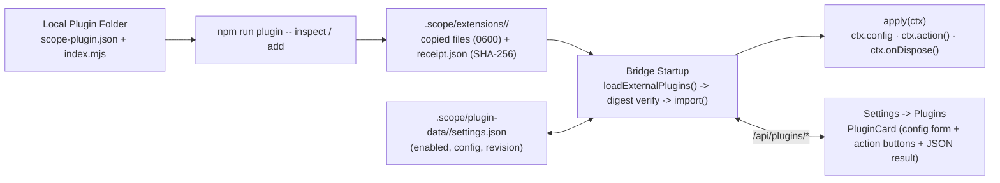

# SCOPE Plugin Integration & Development Guide (Protocol v1)

[English](./plugin-protocol.md) | [简体中文](./plugin-protocol.zh-CN.md)

> **SCOPE — One monitor for all agent sessions.**  
> Extend SCOPE with custom cluster monitors, experiment trackers, GPU job inspectors, or team workflows without forking the core codebase.

> **Security & Trust Boundary**: External plugins execute **in-process** inside the Bridge Node.js runtime with the same filesystem, network, and SSH privileges as SCOPE itself. `capabilities` and `permissions` in `scope-plugin.json` are declarative UI disclosures—**not a sandbox**. Only inspect, install, and enable plugin source code you trust.

---

## 1. Architecture & Plugin Lifecycle



### Runtime State Machine
Every external plugin moves cleanly through 5 states:
- `disabled`: Installed, not enabled in Settings (or Bridge stopped). No code is imported.
- `loading`: Re-verifying SHA-256 package integrity, importing ESM entry, running `apply(ctx)`.
- `idle`: Ready to execute actions declared in `manifest.actions`.
- `running`: Currently executing an action (concurrent invocations and config writes return `409 Conflict`).
- `error`: Integrity mismatch, missing action registration, or exception inside `apply(ctx)`.

Whenever you disable a plugin, save updated settings, or shut down the Bridge, SCOPE increments an internal mount generation and runs all registered `ctx.onDispose(fn)` callbacks in **reverse order** to clean up timers, sockets, or child processes.

---

## 2. Quickstart: Try the Bundled Example Plugin

From the repository root on the machine running SCOPE:

```sh
# 1. Validate manifest, file allowlist, size limits, and compute SHA-256 digest (executes zero code)
npm run plugin -- inspect ./examples/plugins/hello

# 2. Install into .scope/extensions/hello-scope/
npm run plugin -- add ./examples/plugins/hello

# 3. Verify installed packages and digests
npm run plugin -- list
```

Next:
1. Restart SCOPE (`npm run scope` or `node bridge/start.mjs --skip-build`).
2. Open **Settings → Plugins** and click **Refresh**.
3. Check **Enable plugin**, edit the **Greeting** field if desired, and click **Save plugin settings**.
4. Click **Test plugin** to run its action and view the returned JSON.

To uninstall later:
1. Uncheck **Enable plugin** and save in **Settings → Plugins**.
2. Run:
   ```sh
   npm run plugin -- remove hello-scope
   ```
   *(This archives the package into `.scope/extensions-removed/` and preserves `.scope/plugin-data/hello-scope/settings.json` in case you reinstall.)*
3. Restart SCOPE.

---

## 3. Complete `scope-plugin.json` Manifest Specification

Every external plugin directory must contain `scope-plugin.json` at its root plus the `.mjs` entry file and any listed helper files.

### Valid Minimal Example

```json
{
  "protocolVersion": 1,
  "id": "slurm-inspector",
  "name": "Slurm Queue Inspector",
  "version": "1.0.0",
  "description": "Inspect running and pending Slurm GPU jobs on a configured SSH host.",
  "entry": "index.mjs",
  "files": ["index.mjs"],
  "capabilities": ["ssh:read", "jobs:read"],
  "permissions": [
    "Runs inside the SCOPE Bridge Node.js process",
    "Executes read-only squeue over SSH on the selected host"
  ],
  "settings": [
    {
      "key": "host",
      "type": "ssh-host",
      "label": "Slurm Login Host",
      "placeholder": "gpu-login",
      "requiredWhenEnabled": true
    },
    {
      "key": "partition",
      "type": "text",
      "label": "Partition Filter (optional)",
      "default": ""
    }
  ],
  "actions": [
    {
      "id": "list-jobs",
      "label": "Inspect Slurm Queue",
      "result": "json/v1"
    }
  ]
}
```

### Exact Validation Rules (`bridge/plugins/package.mjs`)

| Field | Required | Validation Rule |
| --- | --- | --- |
| `protocolVersion` | Yes | Must be integer `1` |
| `id` | Yes | Matches `/^[a-z][a-z0-9-]{1,63}$/` (2–64 chars). Cannot collide with built-in IDs (`aliyun-dlc`) |
| `name`, `version`, `description` | Yes | Non-empty strings, max `1000` chars each |
| `entry` | Yes | Must end with `.mjs` and appear in `files` |
| `files` | Yes | Explicit list of `1–100` relative POSIX paths (`/`). Allowed extensions: `.mjs`, `.js`, `.json`, `.md`, `.css`, `.svg`. Must **not** include `scope-plugin.json` or `receipt.json` |
| `capabilities` | Yes | Array of strings (each `<= 500` chars); may be `[]` |
| `permissions` | Yes | Array of human-readable permission disclosure strings (each `<= 500` chars) shown in the UI card |
| `settings` | Yes | Array of field descriptors (may be `[]`); unique `key` matching `/^[a-z][a-zA-Z0-9-]{0,63}$/` |
| `settings[].type` | Yes | `"text"` or `"ssh-host"` (`ssh-host` adds host autocomplete from `~/.ssh/config` and validates `/^[a-zA-Z0-9][a-zA-Z0-9._-]*$/`) |
| `settings[].label` | Yes | String label displayed in the UI form |
| `settings[].default` | No | Optional default string value (max runtime value length: `4096`) |
| `settings[].placeholder` | No | Optional input placeholder string |
| `settings[].requiredWhenEnabled` | No | Boolean; prevents enabling/saving without a non-empty value |
| `actions` | Yes | Array of `{ id, label, result }` (unique `id` matching `/^[a-z][a-z0-9-]{1,63}$/`, string `label`, string `result` such as `"json/v1"`) |
| `view` | **Forbidden for external** | Must be **omitted** in external plugins (`m.view` is reserved for built-in views like `submission-tracker/v1`); external action output renders as formatted JSON in `PluginCard` |

### Packaging & Security Constraints
- **File size limits**: Max `2 MB` per individual file, `10 MB` total package size, max `100` files.
- **No symlinks or junctions**: Every directory segment and file is checked via `lstatSync`; symlinks are rejected.
- **Blocked paths**: Paths containing `node_modules`, `.git`, `.scope`, Windows reserved device names (`con`, `prn`, `aux`, `nul`, `com1`–`com9`, `lpt1`–`lpt9`), case-insensitive duplicates, or common secret filenames (`auth.json`, `credentials.json`, `secret(s).json`, `token(s).json`, `config.json`) are rejected.
- **Zero `npm install` on import**: Bundle any third-party packages into your `.mjs` entry beforehand (e.g., via `esbuild` or `rolldown`), or use Node.js 22 built-in modules (`node:child_process`, `node:fs/promises`, `fetch`, etc.).
- **Tamper detection**: Modifying files inside `.scope/extensions/<id>/` invalidates `receipt.json`'s SHA-256 `digest` and causes the plugin to refuse loading until re-imported.

---

## 4. Runtime Entry API (`apply(ctx)`)

Your `entry` `.mjs` file must export a function `apply(ctx)` (sync or `async`):

```js
import { execFile } from "node:child_process";
import { promisify } from "node:util";

const execFileAsync = promisify(execFile);

export function apply(ctx) {
  const host = ctx.config.host;
  const partition = ctx.config.partition?.trim() || "";

  // Optional background polling with guaranteed cleanup:
  let lastCheckedAt = null;
  const heartbeat = setInterval(() => {
    lastCheckedAt = new Date().toISOString();
  }, 60_000);
  heartbeat.unref?.();
  ctx.onDispose(() => clearInterval(heartbeat));

  // Register every action declared in scope-plugin.json -> manifest.actions
  ctx.action("list-jobs", async () => {
    const sshBin = process.platform === "win32" ? "ssh.exe" : "ssh";
    const remoteCmd = partition
      ? `squeue -p '${partition.replace(/'/g, "'\\''")}' --format="%i|%j|%T|%M|%R" --noheader`
      : `squeue --me --format="%i|%j|%T|%M|%R" --noheader`;

    const { stdout } = await execFileAsync(
      sshBin,
      ["-T", "-o", "BatchMode=yes", "-o", "ConnectTimeout=8", "--", host, remoteCmd],
      { timeout: 15_000, windowsHide: true },
    );

    const jobs = stdout
      .trim()
      .split(/\r?\n/)
      .filter(Boolean)
      .map((line) => {
        const [jobId, name, state, elapsed, reason] = line.split("|");
        return { jobId, name, state, elapsed, reason };
      });

    return {
      host,
      partition: partition || "all",
      checkedAt: new Date().toISOString(),
      heartbeat: lastCheckedAt,
      count: jobs.length,
      jobs,
    };
  });
}
```

### `ctx` Reference

| Member | Behavior |
| --- | --- |
| `ctx.config` | Validated settings object (`Record<string, string>`) matching `manifest.settings`. Re-created whenever the user saves new settings. |
| `ctx.action(id, handler)` | Registers `async (input) => jsonValue` for a declared `manifest.actions[].id`. **All** declared actions must be registered before `apply(ctx)` resolves, otherwise the plugin enters `error` state. |
| `ctx.onDispose(fn)` | Registers a cleanup function (sync or async) called in reverse order on disable, settings reload, or Bridge shutdown. |

**Best practices for plugin authors**:
- Always pass `BatchMode=yes` and explicit timeouts when invoking `ssh` or HTTP endpoints; never hang waiting for interactive stdin.
- Call `.unref()` on background timers and always clear them in `ctx.onDispose(...)`.
- Never return raw API keys, OAuth tokens, or private key material from action handlers—the UI displays action return values verbatim in `<pre>`.
- Validate and shell-quote any user-supplied `ctx.config` values before passing them to remote shell commands.

---

## 5. CLI & HTTP API Reference

### Plugin Management CLI (`npm run plugin -- ...`)

| Command | Effect |
| --- | --- |
| `npm run plugin -- inspect <dir>` | Reads manifest & files only (executes zero code); prints manifest, SHA-256 digest, byte size, and trust warning |
| `npm run plugin -- add <dir>` | Atomically copies validated files (`0600`) and `receipt.json` into `.scope/extensions/<id>/` (refuses overwrite—remove old version first) |
| `npm run plugin -- list` | Lists all installed external packages, manifests, digests, and integrity errors |
| `npm run plugin -- remove <id>` | Archives `.scope/extensions/<id>/` to `.scope/extensions-removed/` while keeping `.scope/plugin-data/<id>/settings.json` |

### Bridge HTTP Endpoints (`127.0.0.1:4815`)

All plugin endpoints return `Cache-Control: no-store`.

| Endpoint | Request Body | Success | Common Error Codes |
| --- | --- | --- | --- |
| `GET /api/plugins` | — | `200 { protocolVersion: 1, plugins: [...], loadErrors: [...] }` | — |
| `GET /api/plugins/:id/config` | — | `200 { manifest, source, enabled, config, revision, status }` | `404` unknown plugin |
| `POST /api/plugins/:id/config` | `{ enabled: boolean, config: {...}, revision: number }` | `200` updated descriptor with incremented `revision` | `400` validation error; `409` stale `revision` or action running |
| `GET /api/plugins/:id/status` | — | `200 { state, result }` | `404` unknown plugin |
| `POST /api/plugins/:id/actions/:action` | JSON object (`{}` default) | `200` (external plugin return value) / `202` (built-in async scan) | `404` unknown plugin/action; `409` plugin disabled, loading, or busy |

---

## 6. Going Further: Built-in Views & Integrating New Agent Providers

Because SCOPE's core positioning is **One monitor for all agent sessions**, there are two extension tiers:

1. **External Plugins (`scope-plugin.json` + `apply(ctx)`)** — Best for cluster/job trackers, WandB/MLflow/Slurm inspectors, custom host diagnostics, and team utilities without modifying SCOPE's source.
2. **Core Contributions (New Agent Providers or Custom Views)**:
   - **Adding a new Agent CLI** (e.g., Aider, OpenCode, Goose, or custom enterprise agents):
     - Add session discovery & transcript parsing in `bridge/session-catalog/probe.py` (and a bounded history reader like `bridge/session-catalog/agy-history.py`).
     - Add an interactive or headless provider adapter in `bridge/providers/` (see `claude-interactive.py` for NDJSON `stream-json` and `antigravity-interactive.py` for ACP JSON-RPC).
     - Add optional auth & quota probing in `bridge/account-quotas.mjs`.
   - **Built-in Plugin with Custom UI View**: See `bridge/plugins/aliyun-dlc/` (`manifest.mjs`, `index.mjs`, `monitor.mjs`, `probe.mjs`) as a reference for built-in plugins registered directly on `PluginRegistry`.

### Protocol v1 Scope & v2 Roadmap
Protocol v1 deliberately keeps the extension surface small, inspectable, and zero-dependency. Planned v2 enhancements include:
- Injected Bridge helpers on `ctx` (`ctx.ssh.run`, `ctx.snapshot.hosts`, `ctx.notify`) so external plugins don't need to spawn `ssh` manually.
- Hot-reload on `plugin add` / `remove` without restarting Bridge.
- Declarative UI result views (tables, badges, status cards) alongside `json/v1`.
