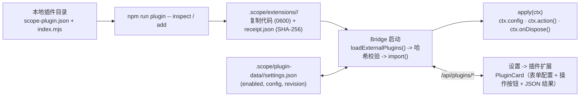

# SCOPE 插件接入与开发指南（Protocol v1）

[English](./plugin-protocol.md) | [简体中文](./plugin-protocol.zh-CN.md)

> **SCOPE — One monitor for all agent sessions.**  
> 无需修改核心源码，即可通过 SCOPE 插件机制接入自定义集群调度器（如 Slurm / K8s / DLC）、实验看板（WandB / MLflow）、GPU 巡检脚本或团队内部工作流。

> **安全边界声明**：本地导入的外部插件运行在 **Bridge 同一个 Node.js 进程** 中，拥有与 SCOPE 相同的本机文件、网络和 SSH 访问权限。清单里的 `capabilities` 与 `permissions` 仅用于在设置页向用户明示用途，**不是沙箱隔离**。请仅导入和启用经过源码审计的插件。

---

## 1. 插件架构与生命周期



### 运行状态流转
每个外部插件拥有 5 种明确状态：
- `disabled`：已安装但未启用（或 Bridge 已停止），**不会执行 `import()`**。
- `loading`：正在重新校验目录 SHA-256 完整性、加载 ESM 入口并执行 `apply(ctx)`。
- `idle`：已就绪，可响应 `manifest.actions` 中声明的操作。
- `running`：正在执行某个操作（期间并发触发操作或保存配置将返回 `409 Conflict`）。
- `error`：完整性校验失败、未注册全部声明操作，或 `apply(ctx)` 抛错。

每当用户停用插件、保存新配置或 Bridge 退出时，SCOPE 会递增挂载代数，并按 **逆序** 调用所有通过 `ctx.onDispose(fn)` 注册的清理函数，安全释放定时器、Socket 或子进程。

---

## 2. 快速上手：体验内置示例插件

在运行 SCOPE 的电脑上进入仓库根目录执行：

```sh
# 1. 只读检查清单、文件白名单、大小限制与 SHA-256 摘要（不执行任何插件代码）
npm run plugin -- inspect ./examples/plugins/hello

# 2. 安装到 .scope/extensions/hello-scope/
npm run plugin -- add ./examples/plugins/hello

# 3. 查看已安装插件与摘要状态
npm run plugin -- list
```

随后：
1. 重启 SCOPE（`npm run scope` 或 `node bridge/start.mjs --skip-build`）。
2. 打开 **设置 → 插件扩展**，点击 **刷新**。
3. 勾选 **启用插件**，按需修改 **问候语**，点击 **保存插件设置**。
4. 点击 **测试插件** 触发操作，页面下方会直接展示格式化后的 JSON 返回结果。

卸载流程：
1. 先在 **设置 → 插件扩展** 中取消勾选 **启用插件** 并保存。
2. 执行卸载命令：
   ```sh
   npm run plugin -- remove hello-scope
   ```
   *（卸载会将代码移入 `.scope/extensions-removed/` 归档，并保留 `.scope/plugin-data/hello-scope/settings.json`，便于后续重装恢复配置。）*
3. 重启 SCOPE。

---

## 3. `scope-plugin.json` 清单完整规范

外部插件包目录下必须包含根目录的 `scope-plugin.json`，以及在 `files` 中显式列出的 ESM `.mjs` 入口与辅助文件。

### 标准完整示例

```json
{
  "protocolVersion": 1,
  "id": "slurm-inspector",
  "name": "Slurm 队列巡检",
  "version": "1.0.0",
  "description": "通过 SSH 只读查看指定登录节点上的 Slurm GPU 作业队列。",
  "entry": "index.mjs",
  "files": ["index.mjs"],
  "capabilities": ["ssh:read", "jobs:read"],
  "permissions": [
    "在 SCOPE Bridge Node.js 进程内运行",
    "在所选 SSH 主机上执行只读 squeue 查询"
  ],
  "settings": [
    {
      "key": "host",
      "type": "ssh-host",
      "label": "Slurm 登录主机",
      "placeholder": "gpu-login",
      "requiredWhenEnabled": true
    },
    {
      "key": "partition",
      "type": "text",
      "label": "分区过滤（可选）",
      "default": ""
    }
  ],
  "actions": [
    {
      "id": "list-jobs",
      "label": "查询 Slurm 队列",
      "result": "json/v1"
    }
  ]
}
```

### 校验规则明细（与 `bridge/plugins/package.mjs` 一一对应）

| 字段 | 必填 | 校验规则 |
| --- | --- | --- |
| `protocolVersion` | 是 | 必须为数字 `1` |
| `id` | 是 | 匹配 `/^[a-z][a-z0-9-]{1,63}$/`（2–64 字符），不能与内置插件 ID（`aliyun-dlc`）冲突 |
| `name`、`version`、`description` | 是 | 非空字符串，单项不超过 `1000` 字符 |
| `entry` | 是 | 必须以 `.mjs` 结尾，且必须包含在 `files` 列表中 |
| `files` | 是 | 显式列出 `1–100` 个相对 POSIX 路径（`/` 分隔），仅允许 `.mjs`、`.js`、`.json`、`.md`、`.css`、`.svg`；**不要**把 `scope-plugin.json` 或 `receipt.json` 列入 `files` |
| `capabilities` | 是 | 字符串数组（每项 `<= 500` 字符），可为空数组 `[]` |
| `permissions` | 是 | 权限说明字符串数组（每项 `<= 500` 字符），会直接展示在设置页插件卡片中 |
| `settings` | 是 | 配置项数组（可为 `[]`），`key` 唯一且匹配 `/^[a-z][a-zA-Z0-9-]{0,63}$/` |
| `settings[].type` | 是 | 支持 `"text"` 或 `"ssh-host"`（`ssh-host` 在设置页自动补全 `~/.ssh/config` 主机并校验 `/^[a-zA-Z0-9][a-zA-Z0-9._-]*$/`） |
| `settings[].label` | 是 | 设置页表单显示名称 |
| `settings[].default` | 否 | 可选默认字符串（运行时配置值最长 `4096` 字符） |
| `settings[].placeholder` | 否 | 输入框占位提示文本 |
| `settings[].requiredWhenEnabled` | 否 | 布尔值；为 `true` 时未填写则禁止启用保存 |
| `actions` | 是 | 操作数组 `{ id, label, result }`，`id` 唯一且匹配 `/^[a-z][a-z0-9-]{1,63}$/`，`result` 一般填 `"json/v1"` |
| `view` | **外部插件禁止填写** | 外部插件必须**省略** `view` 字段（自定义页面视图仅限内置插件如 `submission-tracker/v1`）；外部插件操作结果自动在卡片内以格式化 JSON 展示 |

### 包安全与打包约束
- **体积与数量限制**：最多 `100` 个文件、单文件 `<= 2 MB`、整包 `<= 10 MB`。
- **禁止符号链接**：安装与校验过程逐层使用 `lstatSync` 检查，拒绝软链接与目录联接（Junction）。
- **路径黑名单**：拒绝 `node_modules`、`.git`、`.scope`、Windows 保留设备名（`con`/`prn`/`aux`/`nul`/`com1–9`/`lpt1–9`）、大小写冲突路径，以及常见凭据文件名（`auth.json`、`credentials.json`、`secret(s).json`、`token(s).json`、`config.json`）。
- **导入时不执行 `npm install`**：若需要第三方依赖，请先通过 `esbuild` / `rolldown` 等工具打包进 `.mjs` 文件，或直接使用 Node.js 22 内置模块（`node:child_process`、`node:fs/promises`、`fetch` 等）。
- **防篡改校验**：安装时生成 SHA-256 `digest` 写入 `receipt.json`，每次挂载前重新比对；若事后直接修改 `.scope/extensions/<id>/` 内文件，插件会拒绝加载并提示重新导入。

---

## 4. 入口模块开发指南（`apply(ctx)`）

入口 `.mjs` 文件必须导出 `apply(ctx)` 函数（支持同步或 `async`）：

```js
import { execFile } from "node:child_process";
import { promisify } from "node:util";

const execFileAsync = promisify(execFile);

export function apply(ctx) {
  const host = ctx.config.host;
  const partition = ctx.config.partition?.trim() || "";

  // 如需后台轮询，务必 unref() 并在 onDispose 中释放：
  let lastCheckedAt = null;
  const heartbeat = setInterval(() => {
    lastCheckedAt = new Date().toISOString();
  }, 60_000);
  heartbeat.unref?.();
  ctx.onDispose(() => clearInterval(heartbeat));

  // 必须注册 scope-plugin.json -> actions 中声明的全部操作
  ctx.action("list-jobs", async () => {
    const sshBin = process.platform === "win32" ? "ssh.exe" : "ssh";
    const remoteCmd = partition
      ? `squeue -p '${partition.replace(/'/g, "'\\''")}' --format="%i|%j|%T|%M|%R" --noheader`
      : `squeue --me --format="%i|%j|%T|%M|%R" --noheader`;

    const { stdout } = await execFileAsync(
      sshBin,
      ["-T", "-o", "BatchMode=yes", "-o", "ConnectTimeout=8", "--", host, remoteCmd],
      { timeout: 15_000, windowsHide: true },
    );

    const jobs = stdout
      .trim()
      .split(/\r?\n/)
      .filter(Boolean)
      .map((line) => {
        const [jobId, name, state, elapsed, reason] = line.split("|");
        return { jobId, name, state, elapsed, reason };
      });

    return {
      host,
      partition: partition || "all",
      checkedAt: new Date().toISOString(),
      heartbeat: lastCheckedAt,
      count: jobs.length,
      jobs,
    };
  });
}
```

### `ctx` 运行时接口说明

| 成员 | 说明 |
| --- | --- |
| `ctx.config` | 经清单校验后的配置对象（`Record<string, string>`）；用户在界面修改配置并保存后会重新挂载并传入最新配置 |
| `ctx.action(id, handler)` | 绑定清单中声明的 `actions[].id`，返回可 JSON 序列化的值。`apply(ctx)` 结束前必须把声明的所有操作全部注册完毕，否则进入 `error` 状态 |
| `ctx.onDispose(fn)` | 注册清理回调（支持同步/异步），在停用、重载配置或 Bridge 退出时按逆序调用 |

**插件编写最佳实践**：
- 调用 `ssh` 或 HTTP 请求时务必加 `BatchMode=yes` 与显式超时，避免阻塞卡死。
- 所有 `setInterval` / 连接句柄必须注册 `ctx.onDispose` 清理并尽量调用 `.unref()`。
- **不要**在操作返回值中输出任何 API Key、OAuth Token 或私钥内容——返回值会直接展示在设置页卡片里。
- 将 `ctx.config` 中的用户配置拼接进远端 Shell 命令前，必须做好单引号转义或参数校验。

---

## 5. CLI 命令与 HTTP API 参考

### 插件管理 CLI（`npm run plugin -- ...`）

| 命令 | 作用 |
| --- | --- |
| `npm run plugin -- inspect <目录>` | 只读校验清单、文件列表、体积并计算 SHA-256 摘要（不执行插件代码） |
| `npm run plugin -- add <目录>` | 原子复制到 `.scope/extensions/<id>/`（权限 `0600`）并写入 `receipt.json`（已存在时拒绝覆盖，需先卸载旧版） |
| `npm run plugin -- list` | 列出所有已安装外部插件、清单、摘要及完整性错误 |
| `npm run plugin -- remove <ID>` | 将代码移至 `.scope/extensions-removed/` 归档，同时保留 `.scope/plugin-data/<id>/settings.json` 配置 |

### Bridge 插件 HTTP 接口（`127.0.0.1:4815`）

所有接口均返回 `Cache-Control: no-store`。

| 接口 | 请求体 | 成功响应 | 常见错误码 |
| --- | --- | --- | --- |
| `GET /api/plugins` | — | `200 { protocolVersion: 1, plugins: [...], loadErrors: [...] }` | — |
| `GET /api/plugins/:id/config` | — | `200 { manifest, source, enabled, config, revision, status }` | `404` 插件不存在 |
| `POST /api/plugins/:id/config` | `{ enabled: boolean, config: {...}, revision: number }` | `200` 保存后的最新描述（`revision` 自增） | `400` 校验失败；`409` `revision` 过旧或正在执行操作 |
| `GET /api/plugins/:id/status` | — | `200 { state, result }` | `404` 插件不存在 |
| `POST /api/plugins/:id/actions/:action` | JSON 对象（默认 `{}`） | `200`（外部插件返回值）/ `202`（内置异步扫描） | `404` 插件或操作不存在；`409` 未启用、加载中或执行中 |

---

## 6. 进阶：接入新 Agent 或扩展内置视图

围绕 **SCOPE — One monitor for all agent sessions.** 的定位，提供两层扩展方式：

1. **外部插件（`scope-plugin.json` + `apply(ctx)`）**：适合接入 Slurm / K8s / WandB / MLflow / 自定义主机诊断工具，与主仓解耦、易分发、易回滚。
2. **核心贡献（接入新 Agent Provider 或内置自定义视图）**：
   - **接入新编程 Agent（如 Aider、OpenCode、Goose 或团队自研 Agent）**：
     - 在 `bridge/session-catalog/probe.py` 添加原生会话目录发现，并按需新增有界历史读取器（参考 `bridge/session-catalog/agy-history.py`）。
     - 在 `bridge/providers/` 实现流式交互或单次执行适配器（流式 NDJSON 参考 `claude-interactive.py`，ACP JSON-RPC 参考 `antigravity-interactive.py`）。
     - 在 `bridge/account-quotas.mjs` 补充无密钥的登录态与剩余额度探测。
   - **带自定义页面的内置插件**：可参考 `bridge/plugins/aliyun-dlc/`（`manifest.mjs`、`index.mjs`、`monitor.mjs`、`probe.mjs`）注册到 `PluginRegistry`。

### Protocol v1 边界与 v2 演进规划
Protocol v1 优先保证轻量、可审计、零依赖安装。后续 v2 计划扩展：
- 在 `ctx` 上注入标准 Bridge 能力（如 `ctx.ssh.run`、`ctx.snapshot.hosts`、`ctx.notify`），免去插件自行拼装 SSH 调用。
- 支持 `plugin add` / `remove` 热加载，无需重启 Bridge。
- 支持在 `json/v1` 之外声明式渲染表格、状态徽章与指标卡片。
