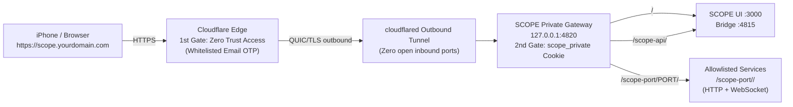

# Remote & Mobile Access Guide (Tailscale Serve & Custom Cloudflare Domain)

[English](./remote-access.md) | [简体中文](./remote-access.zh-CN.md)

Control your **Claude Code**, **Codex**, and **Antigravity (`agy`)** sessions — plus inspect remote dev servers (`/scope-port/<port>/`) — from your **iPhone, Android, tablet, or laptop** in under 3 minutes, **with zero telemetry, zero SaaS relay, and zero credential upload**.

---

## Why Self-Hosted SCOPE? (Zero-Exfiltration Privacy Model)

Before exposing any coding-agent workbench outside `localhost`, verify what leaves your machine:

| Property | SCOPE Guarantee |
| --- | --- |
| **Telemetry & analytics** | **None.** Zero background beacons, zero crash reporters, zero cloud accounts. |
| **Session transcripts & prompts** | Read directly from native CLI files (`~/.codex`, `~/.claude`, `~/.gemini`) only on your own control plane — never synced to third-party servers. |
| **Agent OAuth tokens & SSH keys** | **Never leave the host where they live.** Quota checks (`/usage`) execute locally on each host and return only numeric percentages. |
| **Outbound connections** | No SCOPE-operated server exists. SCOPE itself only contacts: your SSH hosts; provider services through their **unmodified official CLIs** (e.g. `claude -p /usage`, `codex app-server`, `agy -p /usage`); `registry.npmjs.org` **only when you click a Codex upgrade check**; and your own SMTP server if you enable email notifications. SCOPE never reads Claude credential files or the macOS keychain; Codex `auth.json` is read only on its own host to display account identity and switch saved profiles, and is never sent anywhere by SCOPE. |
| **Network binding** | Web UI (`127.0.0.1:3000`), Bridge (`127.0.0.1:4815`), and Private Gateway (`127.0.0.1:4820`) bind strictly to loopback by default. |
| **Auditable open source** | MIT-licensed, 2 runtime dependencies (`ws`, `nodemailer`), built-in secret scanner (`npm run export:opensource -- --check`). |

---

## Choose Your Remote Access Mode

| Mode | Best For | Public Internet? | Custom Domain? | Auth Layers | Setup Time |
| --- | --- | --- | --- | --- | --- |
| **Track 1: Tailscale Serve** | Fastest private mesh across your laptop + phone (no domain needed) | **No** (Private Tailnet only) | `*.ts.net` (auto HTTPS) | Tailscale Identity + SCOPE `HttpOnly` Cookie Token | ~2 min |
| **Track 2: Cloudflare Tunnel + Zero Trust Access** | Custom domain (`https://scope.yourdomain.com`), any phone/browser without VPN client | Edge only (**zero open server ports**) | **Yes** | **Double Auth**: Cloudflare Zero Trust Email OTP + SCOPE `HttpOnly` Cookie Token | ~3 min |
| **SSH Port Forwarding** | Laptop-only access to a Linux jump host | No | No | SSH Key | ~10 sec |
| **LAN HTTPS Gateway** | Offline lab Wi-Fi or isolated intranet | No | LAN IP | Client IP Allowlist + TLS + Token | ~3 min |

---

## Step 0: Install `@godchaser/scope`

Requires **Node.js `>= 22.13`** and **Python 3** on the machine running SCOPE (your laptop, desktop, or persistent Linux VPS).

```sh
npm install -g @godchaser/scope
scope --version
```

> Want to run straight from source instead of npm? Clone `https://github.com/securityCFS/SCOPE.git`, run `npm ci && npm run build`, and invoke `node bin/scope.mjs` wherever `scope` appears below.

---

## Track 1: Tailscale Serve (2-Minute Private Tailnet Setup)

Best when you want private HTTPS access from your iPhone, iPad, or secondary laptop without buying a domain or touching public DNS.

### 1. Start SCOPE with the built-in Private Access Gateway

On macOS, Windows, or Linux foreground:

```sh
scope start --gateway
```

Or on a persistent Linux server (`systemd --user`, survives SSH logout):

```sh
scope service install --with-gateway
loginctl enable-linger "$USER"
```

This binds three loopback-only listeners:
- Web UI: `http://127.0.0.1:3000`
- Bridge API: `http://127.0.0.1:4815`
- Authenticated Private Gateway: `http://127.0.0.1:4820`

### 2. Expose privately over Tailscale Serve

Make sure [Tailscale](https://tailscale.com/download) is signed in (`tailscale up`) on both the SCOPE machine and your phone, then run:

```sh
scope expose tailscale
```

Under the hood this runs `tailscale serve --bg --https=443 http://127.0.0.1:4820` and prints your private Tailnet URL (`https://<your-machine>.<your-tailnet>.ts.net`).

> **Security Rule**: Always use `tailscale serve` (private to your own tailnet). **Never** run `tailscale funnel` (which opens the endpoint to the public internet without Cloudflare Access).

Need to preview without changing anything first?

```sh
scope expose tailscale --dry-run
```

Need to turn it off later?

```sh
scope expose tailscale --off
```

### 3. Sign in from your phone (one-tap URL or manual token)

Print a **single-use** one-tap login URL (valid for 10 minutes; your `0600`-protected 32-byte master token stays in `~/.scope/private-access.json` and is never put in a URL — add `--show` to print it for manual entry):

```sh
scope token --url https://<your-machine>.<your-tailnet>.ts.net
```

Opening the printed `Login URL` consumes its one-time `?scope_login=` code, issues an `HttpOnly; Secure; SameSite=Lax` cookie (`scope_private`) via `303 Redirect`, and strips the code from the address bar. A used or expired link only shows the login page, so a leaked URL from browser history is worthless. Old `?token=<master token>` links no longer sign anyone in. Untrusted (temporary) sessions use a random per-login secret held only in gateway memory, so **Sign out**, **Revoke others**, or a gateway restart invalidates them; trusted devices are listed and revocable under **Settings → Trusted Devices**.

---

## Track 2: Custom Domain via Cloudflare Named Tunnel + Zero Trust Access

Best when you want your own memorable URL such as **`https://scope.yourdomain.com`** accessible from any phone or browser with **zero open inbound ports on your server** and **enterprise-grade double authentication** (Cloudflare Zero Trust Access + SCOPE's own access token).



### Prerequisites
- A domain whose DNS is managed by Cloudflare (free Cloudflare plan works completely).
- [`cloudflared`](https://developers.cloudflare.com/cloudflare-one/connections/connect-networks/downloads/) installed on the SCOPE machine.

<details>
<summary>Quick install of <code>cloudflared</code> on Linux (no root required)</summary>

```sh
mkdir -p ~/.local/bin
curl -fsSL https://github.com/cloudflare/cloudflared/releases/latest/download/cloudflared-linux-amd64 -o ~/.local/bin/cloudflared
chmod +x ~/.local/bin/cloudflared
export PATH="$HOME/.local/bin:$PATH"
cloudflared --version
```

</details>

### 1. Authorize `cloudflared` once

```sh
cloudflared tunnel login
```

Open the printed URL in your browser and authorize the Cloudflare zone for `yourdomain.com`. This writes `~/.cloudflared/cert.pem`.

### 2. Configure the Named Tunnel & DNS in one command

Preview the full plan first (zero files modified):

```sh
scope expose cloudflare --domain scope.yourdomain.com --dry-run
```

Apply it automatically:

```sh
scope expose cloudflare --domain scope.yourdomain.com --tunnel scope-hub
```

What `scope expose cloudflare` does safely:
1. Creates the named tunnel (`scope-hub`) if it does not exist yet.
2. Creates/updates the Cloudflare DNS `CNAME` record for `scope.yourdomain.com`.
3. Backs up any existing `~/.cloudflared/config.yml` and writes a clean `0600` ingress config routing `scope.yourdomain.com` strictly to `http://127.0.0.1:4820` (with a `404` catch-all).
4. Ensures your 32-byte SCOPE gateway secret exists in `~/.scope/private-access.json` (`0600`).

### 3. Start persistent services

**On Linux (`systemd --user`, recommended for 24/7 cloud hubs / workstations):**

```sh
scope service install --with-gateway --with-cloudflared --tunnel scope-hub
loginctl enable-linger "$USER"
scope service status
```

This installs and starts three user services:
- `scope-workbench.service` (`127.0.0.1:3000` + `127.0.0.1:4815`)
- `scope-private-gateway.service` (`127.0.0.1:4820`)
- `scope-cloudflared.service` (outbound QUIC tunnel to Cloudflare Edge)

**On macOS or Windows:**

```sh
# Terminal 1 (UI + Bridge + Private Gateway)
scope start --gateway

# Terminal 2 (Cloudflare Tunnel)
cloudflared tunnel --config ~/.cloudflared/config.yml run scope-hub
```

### 4. Lock the domain behind Cloudflare Zero Trust Access (Critical Double Auth)

Even though SCOPE's Private Gateway already requires a 32-byte cryptographic token, putting **Cloudflare Zero Trust Access** in front guarantees unauthorized visitors never even reach your server:

1. Open [Cloudflare Zero Trust Dashboard](https://one.dash.cloudflare.com/) -> **Access** -> **Applications** -> **Add an application** -> **Self-hosted**.
2. Set **Application domain** to `scope.yourdomain.com`.
3. Under **Policies**, add an **Allow** policy:
   - **Include** -> **Emails** -> enter **ONLY your own email address(es)** (e.g. `you@example.com`).
   - **CRITICAL WARNING**: Do **NOT** add **Login Methods** (such as `One-time PIN`) inside the **Include** section! Cloudflare Access treats multiple **Include** rules as logical **OR** (`Emails OR One-time PIN`), which would allow *any* email address to request a PIN.
4. Configure **One-time PIN** (or GitHub / Google OAuth) under the application's **Authentication** / **Login methods** tab instead.
5. Save the application and verify from any terminal:

```sh
curl -sI https://scope.yourdomain.com/ | grep -iE "^HTTP/|^location:"
```

You should see **`HTTP/2 302`** redirecting to `https://<your-team>.cloudflareaccess.com/cdn-cgi/access/login/scope.yourdomain.com`.

### 5. Sign in from your phone (iPhone / Android PWA)

Print your one-tap login URL:

```sh
scope token --url https://scope.yourdomain.com
```

1. Open `https://scope.yourdomain.com` (or the one-tap URL) on your phone.
2. Complete Cloudflare Access Email OTP once. **Tip**: In Cloudflare Zero Trust -> **Access** -> **Applications** -> your SCOPE app -> **Settings**, increase **Session Duration** from `24 hours` to **`1 month`** so mobile browsers rarely ask for another OTP.
3. Enter your SCOPE access token once with **"Trust this device"** checked (enabled by default, or automatically registered when using the single-use Login URL). SCOPE issues an independent **90-day sliding `SameSite=Lax` HttpOnly cookie** (auto-renewed on activity) and supports iOS iCloud Keychain autofill — refreshing or reopening never asks to re-verify!
4. Manage or revoke individual devices anytime in **Settings -> General -> Trusted Devices** or via CLI (`scope devices list`, `scope devices revoke <id|--all>`).
5. **iPhone Tip**: In Safari, tap **Share -> Add to Home Screen** to launch SCOPE full-screen with safe-area padding like a native app.

---

## Remote Dev Server & Web UI Viewing (`/scope-port/<port>/`)

When accessing SCOPE remotely via Tailscale Serve or Cloudflare Tunnel (`https://scope.yourdomain.com`), you cannot directly open `http://127.0.0.1:6006` on your phone.

SCOPE's Private Gateway includes a **Zero-SSRF Authenticated Port Proxy** at `/scope-port/<port>/`:

1. Tap the **Ports** button in any conversation header (`@local` on Linux or any remote SSH host), or tap any `http://localhost:<port>` link in an agent's reply.
2. Click **Open** / **Forward** (or enter a port number such as `4871`, `6006`, `7860`, `8888`):
   - For **remote SSH hosts**, SCOPE opens a loopback SSH `-L` tunnel and adds the local port to the active allowlist.
   - For **`@local` (POSIX)**, SCOPE verifies a local listener is active and adds it directly to the allowlist without spawning extra SSH processes.
3. Your phone automatically opens `https://scope.yourdomain.com/scope-port/<port>/` — supporting **HTTP, HTML `<base>`/link rewriting, `3xx` redirect rewriting, scoped cookies, streaming responses, and WebSockets (`wss://`)** for TensorBoard, Gradio, Streamlit, Jupyter, Swagger, Vite previews, and custom Python/Node servers.
4. **Security guarantees on `/scope-port/<port>/`**:
   - Protected by the exact same **Cloudflare Access + `scope_private` Cookie** gates.
   - **Strict allowlist**: Any port not currently active in SCOPE Bridge returns `403 Forbidden`. Clicking **Stop / Revoke** cuts off access immediately.
   - **Hard-blocked control ports**: Ports `22`, `53`, `2019`, `3000`, `4815`, `4820`, `4822`, `4880`, `4922`, plus the active UI/Bridge/Gateway ports can never be proxied.
   - **Zero credential leakage**: `scope_private`, `CF_Authorization`, and Cloudflare JWT headers are stripped before requests reach the proxied app, and proxied apps cannot overwrite gateway cookies.

---

## Token Rotation & Operations

```sh
# Check token file path (does not print secret)
scope token

# Print token and one-tap URL
scope token --url https://scope.yourdomain.com

# List or revoke trusted mobile/browser devices (hot-reloads within ~2s, no restart needed)
scope devices list
scope devices revoke <device-id>
scope devices revoke --all

# Rotate master token (revokes all trusted devices by default; pass --keep-devices to preserve them)
scope token --rotate --url https://scope.yourdomain.com
scope service restart   # or restart `scope start --gateway`

# Inspect or uninstall Linux systemd services
scope service status
scope service uninstall
```

---

## Troubleshooting

| Symptom | Cause | Fix |
| --- | --- | --- |
| `https://scope.yourdomain.com` shows Cloudflare `502 Bad Gateway` | Private Gateway (`127.0.0.1:4820`) is not running | Run `scope service status` (or start `scope start --gateway`) and check `curl -I http://127.0.0.1:4820/` returns `401`. |
| Anyone's email receives Cloudflare Access OTP | `Login Methods` was placed inside `Include` alongside `Emails` | Edit your Cloudflare Access policy and remove `Login Methods` from `Include`; keep **only `Emails`** in `Include`. |
| `/scope-port/4871/` returns `403 Forbidden` | Port `4871` has not been exposed/forwarded in SCOPE yet, or is a blocked system port | Open the **Ports** menu inside SCOPE, expose/forward `4871`, then open it from the button. |
| `scope expose tailscale` says `Tailscale backend state is Stopped` | Tailscale daemon is not logged in | Run `tailscale up` first, then re-run `scope expose tailscale`. |
| Services stop when SSH disconnects on Linux | systemd user lingering is disabled | Run `loginctl enable-linger "$USER"` once. |
