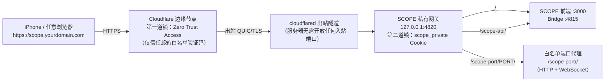

# 远程与手机端部署教程（Tailscale Serve 与自定义 Cloudflare 域名）

[English](./remote-access.md) | [简体中文](./remote-access.zh-CN.md)

3 分钟内完成 **iPhone / Android 手机、平板与跨网电脑** 安全访问你的 **Claude Code**、**Codex** 和 **Antigravity (`agy`)** 会话，并支持直接在手机浏览器打开服务器本地 Web 服务（`/scope-port/<port>/`）。全程 **零遥测、零云端中转、零凭据上传**。

---

## 为什么选择自托管 SCOPE？（零外传隐私架构）

在把任何 Coding Agent 工作台接入远程访问前，你可以直接审计 SCOPE 的数据边界：

| 安全维度 | SCOPE 架构承诺 |
| --- | --- |
| **遥测与数据回传** | **零遥测。** 无统计埋点、无崩溃上报、无需注册第三方云账号。 |
| **对话记录与提示词** | 仅由你自己掌控的控制端直接读取原生 CLI 文件（`~/.codex`、`~/.claude`、`~/.gemini`），绝不上传到任何外部服务器。 |
| **Claude / Codex / AGY 凭据与 SSH 密钥** | **凭据永不离开所在主机。** `/usage` 额度查询直接在目标主机本地完成，只回传数值百分比，不回传 OAuth Token 或 Cookie。 |
| **出站连接** | 不存在任何 SCOPE 运营的服务器。SCOPE 自身只会连接：你的 SSH 主机；通过**未修改的官方 CLI** 访问各服务商（如 `claude -p /usage`、`codex app-server`、`agy -p /usage`）；**仅在你点击 Codex 升级检查时**访问 `registry.npmjs.org`；以及启用邮件通知时你自己的 SMTP 服务器。SCOPE 不读取 Claude 凭据文件或 macOS 钥匙串；Codex 的 `auth.json` 只在其所在主机本地读取，用于显示账号身份和切换已保存的 Profile，SCOPE 不会将其发送到任何地方。 |
| **默认网络监听** | 前端（`127.0.0.1:3000`）、Bridge（`127.0.0.1:4815`）与私有网关（`127.0.0.1:4820`）默认全部仅监听本机回环。 |
| **轻量可审计开源** | MIT 协议，生产运行时仅 2 个依赖（`ws`、`nodemailer`），内置防泄漏扫描（`npm run export:opensource -- --check`）。 |

---

## 四种远程访问方案对比

| 方案 | 适用场景 | 暴露公网？ | 自定义域名？ | 鉴权层数 | 部署耗时 |
| --- | --- | --- | --- | --- | --- |
| **方案一：Tailscale Serve** | 自己手机 + 电脑私网直连，不需要买域名 | **否**（仅自己的 Tailnet 可见） | `*.ts.net`（自动 HTTPS） | Tailscale 身份 + SCOPE `HttpOnly` Cookie 密钥 | 约 2 分钟 |
| **方案二：Cloudflare 命名隧道 + Zero Trust Access** | 绑定自定义域名（如 `https://scope.yourdomain.com`），免装 VPN 客户端随时打开 | 仅经 Cloudflare 边缘节点（**服务器零开放入站端口**） | **支持** | **双重防护**：Cloudflare 邮箱白名单 OTP + SCOPE `HttpOnly` Cookie 密钥 | 约 3 分钟 |
| **SSH 端口转发** | 仅用电脑通过跳板机访问 | 否 | 否 | SSH 密钥 | 约 10 秒 |
| **局域网 HTTPS 网关** | 实验室纯内网 / 离线 Wi-Fi | 否 | 局域网 IP | 客户端 IP 白名单 + TLS + 访问密钥 | 约 3 分钟 |

---

## 第 0 步：通过 npm 安装 `@godchaser/scope`

控制端机器（你的笔记本、台式机或常驻 Linux 云主机）需安装 **Node.js `>= 22.13`** 与 **Python 3**。

```sh
npm install -g @godchaser/scope
scope --version
```

> 若从源码仓库运行：克隆 `https://github.com/securityCFS/SCOPE.git` 并执行 `npm ci && npm run build`，将下文命令中的 `scope` 替换为 `node bin/scope.mjs` 即可。

---

## 方案一：Tailscale Serve（2 分钟私网零公网部署）

无需购买域名、无需配置 DNS，适合已经或愿意使用 Tailscale 的开发者，几条命令即可在手机上通过专属 HTTPS 地址访问。

### 1. 一键启动 SCOPE 与内置私有网关

在 macOS、Windows 或 Linux 前台启动：

```sh
scope start --gateway
```

或在常驻 Linux 服务器上注册为 `systemd --user` 后台服务（退出 SSH 不掉线）：

```sh
scope service install --with-gateway
loginctl enable-linger "$USER"
```

启动后全部仅监听本机回环：
- Web 工作台：`http://127.0.0.1:3000`
- Bridge API：`http://127.0.0.1:4815`
- 鉴权私有网关：`http://127.0.0.1:4820`

### 2. 一键接入 Tailscale Serve

确保控制端和手机均已安装并登录 [Tailscale](https://tailscale.com/download)（执行过 `tailscale up`），然后运行：

```sh
scope expose tailscale
```

该命令会自动校验 Tailscale 登录态，执行 `tailscale serve --bg --https=443 http://127.0.0.1:4820`，并输出你的私有 Tailnet 地址（`https://<机器名>.<你的tailnet>.ts.net`）。

> **安全红线**：始终只使用仅限 Tailnet 内部可见的 `tailscale serve`，**切勿使用** 会将端口暴露给全公网的 `tailscale funnel`。

想先预览命令但不做修改？

```sh
scope expose tailscale --dry-run
```

后续想随时关闭映射？

```sh
scope expose tailscale --off
```

### 3. 获取访问密钥并在手机端登录

生成**一次性**一键登录链接（10 分钟内有效；`0600` 权限的 32 字节主密钥保存在 `~/.scope/private-access.json`，不会出现在 URL 中，需要手动输入时加 `--show` 显示）：

```sh
scope token --url https://<机器名>.<你的tailnet>.ts.net
```

在手机浏览器打开输出的 `Login URL` 后，网关会消耗其中的一次性 `?scope_login=` 登录码，通过 `303` 重定向写入 `HttpOnly; Secure; SameSite=Lax` Cookie（`scope_private`），并将登录码从地址栏移除。链接 10 分钟内有效且只能使用一次，已使用或过期的链接只会显示登录页，因此即使出现在浏览器历史中也无法被复用；主访问密钥永远不会出现在 URL 中（需要手动输入时可加 `--show` 显示）。旧的 `?token=<主密钥>` 链接已不再能登录。未勾选信任的临时会话使用每次登录随机生成、仅保存在网关内存中的密钥，**退出登录**、**移除其他设备** 或重启网关都会使其失效；受信任设备可在 **设置 → 受信任设备** 中查看和单独吊销。

---

## 方案二：自定义域名 + Cloudflare Named Tunnel + Zero Trust Access

适合希望用自己域名（如 **`https://scope.yourdomain.com`**）随时在手机/平板/任意浏览器打开，同时做到 **服务器防火墙零放行端口** 与 **Cloudflare Access + SCOPE 密钥双重鉴权** 的场景。



### 前置条件
- 一个已托管在 Cloudflare DNS 下的自定义域名（Cloudflare 免费版即可完整使用）。
- 在运行 SCOPE 的机器上安装 [`cloudflared`](https://developers.cloudflare.com/cloudflare-one/connections/connect-networks/downloads/)。

<details>
<summary>Linux 无 root 快速安装 <code>cloudflared</code></summary>

```sh
mkdir -p ~/.local/bin
curl -fsSL https://github.com/cloudflare/cloudflared/releases/latest/download/cloudflared-linux-amd64 -o ~/.local/bin/cloudflared
chmod +x ~/.local/bin/cloudflared
export PATH="$HOME/.local/bin:$PATH"
cloudflared --version
```

</details>

### 1. 一次性授权 `cloudflared`

```sh
cloudflared tunnel login
```

在浏览器打开终端输出的授权链接，选中你的域名 `yourdomain.com` 完成授权（证书保存在 `~/.cloudflared/cert.pem`）。

### 2. 一条命令完成命名隧道、DNS 绑定与配置写入

可以先用 `--dry-run` 预览全部步骤（不修改任何文件）：

```sh
scope expose cloudflare --domain scope.yourdomain.com --dry-run
```

确认无误后直接执行：

```sh
scope expose cloudflare --domain scope.yourdomain.com --tunnel scope-hub
```

`scope expose cloudflare` 会自动安全地完成：
1. 若 `scope-hub` 隧道不存在则自动创建。
2. 自动配置 `scope.yourdomain.com` 的 Cloudflare DNS 隧道解析。
3. 若已有 `~/.cloudflared/config.yml` 会先备份，再以 `0600` 权限写入仅指向 `http://127.0.0.1:4820` 的入站规则（其余路径默认 `404`）。
4. 确保 `~/.scope/private-access.json`（`0600`）已生成 32 字节私有访问密钥。

### 3. 启动常驻服务

**Linux 服务器（推荐 `systemd --user` 常驻）：**

```sh
scope service install --with-gateway --with-cloudflared --tunnel scope-hub
loginctl enable-linger "$USER"
scope service status
```

上述命令会安装并启用三个用户级服务：
- `scope-workbench.service`（`127.0.0.1:3000` 前端 + `127.0.0.1:4815` Bridge）
- `scope-private-gateway.service`（`127.0.0.1:4820` 私有网关）
- `scope-cloudflared.service`（出站加密隧道，无需服务器安全组开放端口）

**macOS / Windows：**

```sh
# 终端 1：启动前端 + Bridge + 私有网关
scope start --gateway

# 终端 2：启动 Cloudflare 隧道
cloudflared tunnel --config ~/.cloudflared/config.yml run scope-hub
```

### 4. 配置 Cloudflare Zero Trust Access（强烈建议开启双重防护）

虽然 SCOPE 网关本身已经有 32 字节密钥校验，但在 Cloudflare 边缘加上 Access 后，未授权流量连你的服务器都触碰不到：

1. 打开 [Cloudflare Zero Trust 控制台](https://one.dash.cloudflare.com/) -> **Access** -> **Applications** -> **Add an application** -> 选择 **Self-hosted**。
2. 将 **Application domain** 设为 `scope.yourdomain.com`。
3. 新建一条 **Allow** 策略（Policy）：
   - 在 **Include** 中选择 **Emails**，**只填写你自己的信任邮箱**（例如 `you@example.com`）。
   - **关键避坑提醒**：**千万不要**在 **Include** 里再额外添加 **Login Methods（如 One-time PIN）**！Cloudflare Access 对同一组 **Include** 里的多条规则采用 **逻辑或（OR）** 判定，把 `One-time PIN` 放进 `Include` 会导致任意陌生邮箱都能收验证码通过。
4. 登录方式（`One-time PIN` 或 GitHub / Google 登录）请仅在应用的 **Authentication / Login methods** 标签页勾选。
5. 保存后在终端验证防护已生效：

```sh
curl -sI https://scope.yourdomain.com/ | grep -iE "^HTTP/|^location:"
```

返回 **`HTTP/2 302`** 且 `Location` 指向 `https://<你的团队>.cloudflareaccess.com/cdn-cgi/access/login/scope.yourdomain.com` 即表示双重防护已就绪。

### 5. 手机端登录与桌面 App 体验

打印你的密钥与一键登录地址：

```sh
scope token --url https://scope.yourdomain.com
```

1. 在手机浏览器打开 `https://scope.yourdomain.com`（或上述一键登录链接）。
2. 先通过 Cloudflare Access 信任邮箱一次性验证码。**强烈建议**：在 Cloudflare Zero Trust -> **Access** -> **Applications** -> 你的 SCOPE 应用 -> **Settings** 中，将 **Session Duration（会话有效期）** 从默认的 `24 hours` 调高为 **`1 month`**，这样邮箱验证层也不会每天弹窗。
3. 再输入一次 SCOPE 访问密钥，保持勾选 **“信任此设备（90 天自动续期免密）”**（或使用一次性登录链接自动注册受信任设备）。SCOPE 会为该手机颁发独立的加密设备凭证并写入 `SameSite=Lax` + `HttpOnly` 长期 Cookie（活跃自动续期，且支持 iOS iCloud 钥匙串自动保存），刷新页面或从主屏幕重新打开均不再重复验证。
4. 随时可在网页端 **设置 -> 常规 -> 受信任设备** 中查看/重命名/单台吊销，或在主机终端执行 `scope devices list` / `scope devices revoke <id|--all>`（2 秒内热生效，无需重启服务）。
5. **iPhone 使用技巧**：在 Safari 点击底部 **分享 -> 添加到主屏幕**，即可全屏 PWA 沉浸式使用，自动适配刘海屏与底部安全区。

---

## 手机端直接查看服务器本地 Web 服务（`/scope-port/<port>/`）

当你在手机上访问 `https://scope.yourdomain.com` 时，服务器或远端 GPU 机器上启动的 `http://localhost:4871`、TensorBoard（`6006`）、Gradio（`7860`）、Jupyter（`8888`）无法直接在手机通过 `127.0.0.1` 打开。

SCOPE 私有网关内置了 **零 SSRF 认证端口代理（`/scope-port/<port>/`）**：

1. 在任意会话顶部点击 **端口** 按钮（同时支持 Linux `@local` 本机服务与远端 SSH 主机服务），或直接点击 Agent 回复里的 `http://localhost:<port>` 链接。
2. 点击 **开放打开** / **转发打开**，或在底部输入框填写任意端口（如 `4871`）：
   - 对 **远端 SSH 主机**：自动建立回环 SSH `-L` 隧道并加入代理白名单。
   - 对 **Linux `@local` 主机**：直接校验本机回环监听存活并加入白名单，不拉起多余 SSH 进程。
3. 手机浏览器会自动跳转到 `https://scope.yourdomain.com/scope-port/<port>/`，原生支持 **HTTP、HTML `<base>` 与根路径属性重写、`3xx` 重定向重写、隔离路径 Cookie、流式传输以及 WebSocket (`wss://`)**。
4. **安全隔离机制**：
   - 继承同一套 **Cloudflare Access + `scope_private` Cookie** 双重鉴权。
   - **严格白名单**：未在 SCOPE 中主动开放的端口一律返回 `403`；在弹窗点击停止后立即失效。
   - **系统/控制端口硬屏蔽**：`22`、`53`、`2019`、`3000`、`4815`、`4820`、`4822`、`4880`、`4922` 以及当前 UI/Bridge/Gateway 端口永久禁止通过 `/scope-port/` 访问。
   - **零凭据泄漏**：代理请求前自动剥离 `scope_private`、`CF_Authorization` 与 Cloudflare JWT 头，并禁止业务页面覆盖网关 Cookie。


### 为转发端口启用独立域名隔离（强烈建议）

默认情况下 `/scope-port/<port>/` 与 SCOPE 控制台同源，因此**被转发页面中的任意 JavaScript 都拥有与 SCOPE 工作台相同的浏览器权限**：可以携带你的会话 Cookie 调用 `/scope-api`，进而操控所有主机上的 Agent 与终端。只有在你完全信任端口内容时这才可以接受；带恶意 npm 依赖的开发服务器、存在 XSS 的页面或他人分享的 Notebook 都足以接管 SCOPE。（网关始终会剥离转发响应中的 `Service-Worker-Allowed` / `Clear-Site-Data` 并拒绝 Service Worker 脚本，但无法阻止同源 API 调用。）

建议改为由独立主机名提供转发页面：

1. 选择一个被 Universal SSL 覆盖的一级子域名，例如 `scope-ports.yourdomain.com`（不要用 `ports.scope.yourdomain.com`）。
2. 在 **同一个 Cloudflare Access 应用** 中把它添加为第二个公共主机名（Zero Trust → Access → Applications → 你的 SCOPE 应用 → Configure → Add public hostname），并且要在配置 DNS **之前** 完成。
3. 通过同一条 Tunnel 路由并启用隔离：

```sh
scope expose cloudflare --domain scope.yourdomain.com --port-domain scope-ports.yourdomain.com
scope service install --with-gateway --with-cloudflared --tunnel scope-hub --port-origin https://scope-ports.yourdomain.com
```

设置 `SCOPE_PORT_ORIGIN` 后，SCOPE 主域名不再执行任何被转发的内容：打开 `/scope-port/<port>/` 时，网关会签发一张 **60 秒有效的一次性票据** 并跳转到端口域名，由端口域名签发独立的 `scope_port` Cookie（`Path=/scope-port/`，12 小时）。端口域名 **只** 提供 `/scope-port/*`，没有 UI、没有 `/scope-api`、也没有登录入口，因此恶意页面最多只能影响其他被转发的页面。在 SCOPE 中退出登录或吊销设备会同时清空所有端口会话，重新从工作台打开端口即可。

---

## 密钥轮换与常用运维命令

```sh
# 查看密钥文件位置（默认隐藏明文，防录屏/日志泄漏）
scope token

# 显示密钥与一键登录地址
scope token --url https://scope.yourdomain.com

# 查看或吊销受信任设备（运行中网关 2 秒内热生效，无需重启）
scope devices list
scope devices revoke <device-id>
scope devices revoke --all

# 立即轮换主密钥（默认同步清空所有受信任设备；加 --keep-devices 可保留已有信任设备）
scope token --rotate --url https://scope.yourdomain.com
scope service restart   # 或重启 `scope start --gateway`

# 查看或卸载 Linux systemd 常驻服务
scope service status
scope service uninstall
```

---

## 常见排障

| 现象 | 常见原因 | 解决方法 |
| --- | --- | --- |
| 打开域名提示 Cloudflare `502 Bad Gateway` | 本机私有网关（`127.0.0.1:4820`）未启动 | 执行 `scope service status`（或 `scope start --gateway`），确认 `curl -I http://127.0.0.1:4820/` 返回 `401`。 |
| 任意陌生邮箱都能收到 Cloudflare Access 验证码 | 把 `Login Methods` 误放进了策略的 `Include` 里 | 编辑 Access Policy，删掉 `Include` 中的 `Login Methods`，**只保留 `Emails`**。 |
| 访问 `/scope-port/4871/` 返回 `403 Forbidden` | 该端口尚未在 SCOPE 里开放/转发，或属于系统保留端口 | 在会话顶部点 **端口**，对 `4871` 点击开放或转发后再打开。 |
| `scope expose tailscale` 提示未运行 | Tailscale 客户端未登录 | 先运行 `tailscale up` 登录，再重新执行 `scope expose tailscale`。 |
| Linux 退出 SSH 后服务掉线 | 未开启 `systemd` 用户 linger | 执行一次 `loginctl enable-linger "$USER"` 即可。 |
